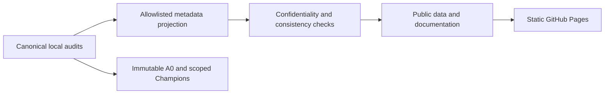

# V100 Volta AI Optimization Lab

<strong>One Volta GPU. Reproducible evidence. Useful local AI.</strong>
Independent community research into inference performance, agent reliability and energy efficiency on a single NVIDIA Tesla V100-SXM2 with 16 GB HBM2.

This project is not affiliated with or endorsed by NVIDIA, Ollama, engine developers or model publishers. Research is ongoing; there is no final universal model winner or automatic production deployment.

## Evidence snapshot

Matrix revision **404**, canonical assessment date **2026-10-23T20:51:24.691209+00:00**.

| Original axes | Additional techniques | Experimentally covered | Qualified factor scopes | Model challengers |
|---|---|---|---|---|
| 130 | 32 | 113 | 6 | 11 |

These are different units: **383 sprint records**, **302 historical signed windows**, **1727 ledger events**, **60 immutable reference records**, **12 current profile champions**. None is a total count of independent GPU experiments.

## Hardware and software

- One Tesla V100-SXM2, 16 GB HBM2; Volta compute capability 7.0 (SM70).
- Research host with an isolated Linux container; serialized device access and a local GPU admission broker.
- CUDA 12.8 llama.cpp/GGUF baseline; driver branch 580.178.04. Engine and weight hashes are recorded per profile.
- FP16 Tensor Cores are available; native BF16/FP8 Tensor Cores, cp.async and TMA are not assumed.
- Context, KV/state precision, graph capture and cache capacity all consume the same limited device memory.
- Temperature is recorded as telemetry. ECC, memory, hardware temperature and restore guards remain mandatory.

## What has helped, and where

- HBM07 conversion-cache work: qualified prompt-evaluation profiles; extra VRAM and largely unchanged decode.
- MTP: scoped coding, native tool and agent profiles. Target decisions and hybrid state correctness remain explicit gates.
- Agent throughput and energy: separate qualified profiles with different latency, energy and memory trade-offs.
- Low-VRAM and long-context profiles: preserve their exact task and numerical limits; a fast prefill screen is not general agent qualification.

See [Qualified configurations](docs/configurations.md), [Rejected optimizations](docs/rejected.md), [Model Comparison & Benchmarks](docs/configuration-comparison.md), [model evidence](docs/models.md) and the full [Optimization matrix](docs/matrix.md).

## How to read the evidence

**LOKAL GEMESSEN / LOCAL MEASUREMENT** means an original hardware measurement exists in the stated scope. **EXTERN BELEGT / EXTERNAL EVIDENCE** means a public source supports an implementation or result. **NICHT VERIFIZIERT / UNVERIFIED** marks a hypothesis or missing local proof. Static source review and independent qualification are separate stages.

Numerical values are exported without invented missing measurements. Original rationale excerpts may remain in German. Public audit excerpts are intentionally incomplete and have different bytes from the original audits whose hashes they cite.

[Open the interactive Benchmark Master Table](docs/configuration-comparison.md): exact configurations, versioned benchmarks, selectable columns, user-defined averages and audit-linked evidence.

## Documentation and collaboration

Build the static website with `pip install -r requirements-docs.txt` and `mkdocs build --strict`. See [reproduction](docs/reproduce.md), [contribution guide](CONTRIBUTING.md), [publication policy](docs/publication.md) and [German overview](docs/de.md). Documentation publishing never launches a GPU job.
