# Model Comparison & Benchmarks

<strong>Measured tasks. Visible trade-offs.</strong>
Separate coding, native tools and agent results on one V100. No combined score and no automatic winner.

- No combined score. Counts are one observed answer per task unless repeated cycles are explicitly stated.
- Whole configurations: model, tokenizer, native template, output budget, sampling, quantization and engine can differ. Task/scorer matching permits comparison of these profiles, not causal architecture claims.
- GPU board energy includes failed task attempts; excludes load/warmup and CPU/system energy. Latency is measured request/case time; startup and judge time are excluded.
- NOT MEASURED means no full comparable audited result in this cohort. Partial screens are not converted into full-suite scores.

Teal bars are measured values; amber identifies a recorded policy warning. NOT MEASURED is never plotted as zero. The tables below each cohort provide exact profile metadata and original audit hashes. Error bars are omitted for single runs; repeated-cycle min–max and historical median absolute deviation (MAD) are labelled explicitly.

Measurement-only fingerprint: `8512d6f94c9f5d66eb839d5a509915648410c0c573b3ab41e8a3481f4ba950c8`. Charts change when these audited measurements/conditions change, independently of matrix revision. New full-suite results are admitted through the existing canonical benchmark reference registry after audit; changed task identities fail the cohort gate rather than silently entering a ranking. Download the [validated aggregate dataset](https://github.com/Maxxxel/v100-volta-ai-optimization-lab/blob/main/data/comparison.json).

## Coding · HumanEvalPlus

HumanEvalPlus frozen 164; base AND plus; HumanEval/32 known invalid retained as failure (163 subset is separate).

Task identity: `cc7377147a38ea139e77745d18fcc35c267dd192d4b99c89d8a4e653ef4d39d5`. **Task-matched whole-configuration comparisons**; native sampling, budgets and builds are shown below. These are development results, with no repeated-seed model-superiority claim. Record dates come from the original audit or frozen plan; missing dates remain labelled.

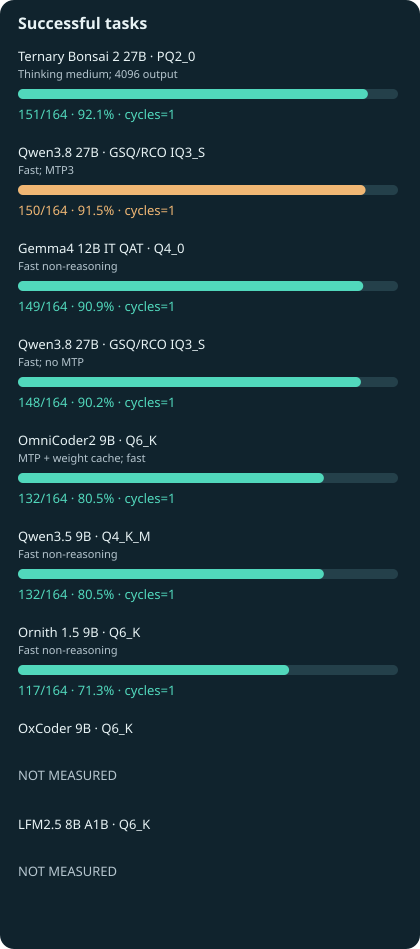{ .benchmark-svg }

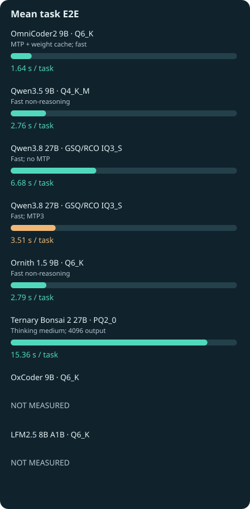{ .benchmark-svg }

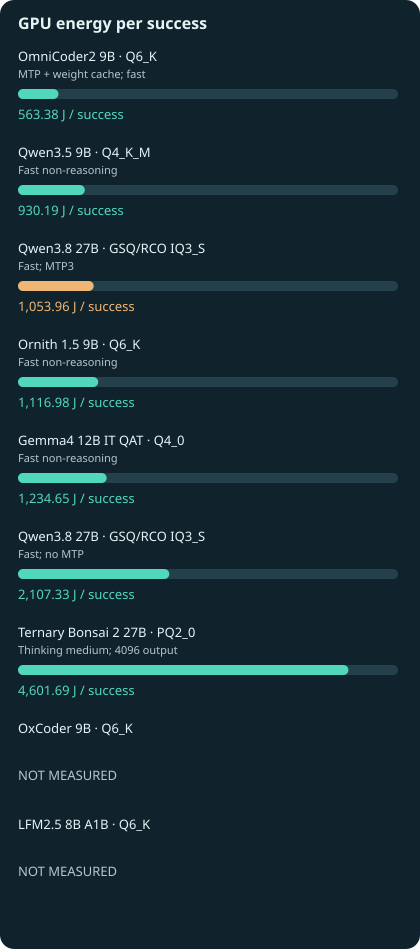{ .benchmark-svg }

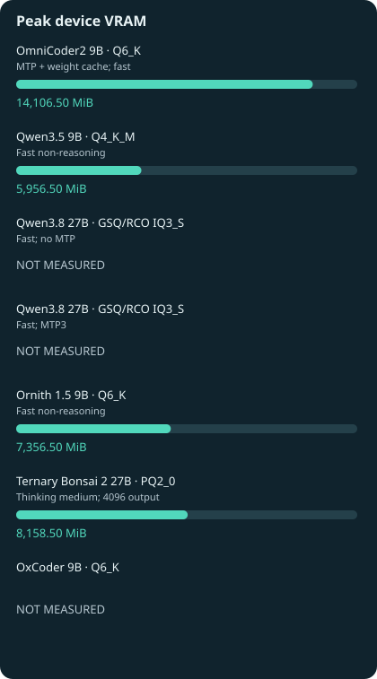{ .benchmark-svg }

| Profile / record date | Success | Successful tasks/s | Total task time / GPU energy | Peak VRAM | Audit |
|---|---|---|---|---|---|
| OmniCoder2 9B Q6_K — MTP + weight cache; fast / 2026-10-20 | 132/164 | 0.49216 | 268.206 s / 74366.52 J | 14106.5 | [R217](experiments/R217.md) |
| Ornith 1.5 9B Q6_K — Fast non-reasoning / 2026-10-20 | 117/164 | 0.25605 | 456.936 s / 130686.39 J | 7356.5 | [R254](experiments/R254.md) |
| Qwen3.5 9B Q4_K_M — Fast non-reasoning / 2026-10-20 | 132/164 | 0.29190 | 452.206 s / 122784.66 J | 5956.5 | [R255](experiments/R255.md) |
| Gemma4 12B IT QAT Q4_0 — Fast non-reasoning / 2026-10-22 | 149/164 | 0.20107 | 741.044 s / 183962.59 J | 8118.5 | [R425](experiments/R425.md) |
| Qwen3.8 27B GSQ/RCO IQ3_S — Fast; no MTP / NOT RECORDED | 148/164 | 0.13504 | 1095.974 s / 311884.76 J | NOT MEASURED | [R117](experiments/R117.md) |
| Qwen3.8 27B GSQ/RCO IQ3_S — Fast; MTP3 / NOT RECORDED | 150/164 | 0.26059 | 575.610 s / 158094.20 J | NOT MEASURED | [R118](experiments/R118.md) |
| Ternary Bonsai 2 27B PQ2_0 — Thinking medium; 4096 output / 2026-10-21 | 151/164 | 0.05993 | 2519.755 s / 694855.82 J | 8158.5 | [R279](experiments/R279.md) |

### OmniCoder2 9B · Q6_K · R217

MTP + weight cache; fast. No additional policy claim is inferred from this discipline.

| Condition | Audited value |
|---|---|
| Separate process-VRAM observation (not device peak) | NOT MEASURED |
| Hardware / power | Tesla V100-SXM2 16 GB HBM2 / 300 W |
| Engine | llama.cpp / CUDA 12.8 / SM70 (exact audited binary below) |
| Date | 2026-10-20 |
| Context, batching, KV, speculation | {"--batch-size": "2048", "--cache-type-k": "f16", "--cache-type-v": "f16", "--ctx-size": "8192", "--reasoning": "off", "--spec-draft-n-max": "3", "--spec-type": "draft-mtp", "--threads": "6", "--ubatch-size": "512"} |
| Sampling / output cap | {"seed": 1001, "temperature": 0} / 1024 |
| Cache / timing scope | Warm model; per-request KV reset; OS file cache uncontrolled; model startup excluded |
| Measurement batches | Single suite or repeated cycles as stated |
| Actual template controls | See pinned native request evidence |
| Actual input-token range (if exported) | Not included in this public aggregate |
| Task count / repeats | 164 unique; one observed answer per task; no repeated-run uncertainty measured |
| Model SHA-256 | 78af5105675a93f2909d625288a87be86ceef620985ab255f72dc028e0290e82 |
| Engine binary SHA-256 | 08827111e1b856c38d7a3a46ef2d33b36f201d3de76afdf4ac60f061c97fce54 |
| Template SHA-256 | a4aee8afcf2e0711942cf848899be66016f8d14a889ff9ede07bca099c28f715 |
| Scorer adapter SHA-256 | dea3b58b17e93734bf27e15e3f07419982b28f622427519a0779c5c8106cf3ad |
| EvalPlus provenance SHA-256 | 332b4dfcdd92cb653859dd392c9e2430726aa85cc6560dcfc76282d06310e64d |
| Plan SHA-256 | a9dbcbb0fe047611864d33b97e5f8dd8c21651c35075bb353a418dc477b2d15c |

Original audit SHA-256 (originals retained privately; public excerpts are not the original files):

- [audit-1f940596d115e34ae02f](audits/audit-1f940596d115e34ae02f.md): `1f940596d115e34ae02fb770a10219149578150e431be646376f8fb223d15c0e`

### Ornith 1.5 9B · Q6_K · R254

Fast non-reasoning. No additional policy claim is inferred from this discipline.

| Condition | Audited value |
|---|---|
| Separate process-VRAM observation (not device peak) | NOT MEASURED |
| Hardware / power | Tesla V100-SXM2 16 GB HBM2 / 300 W |
| Engine | llama.cpp / CUDA 12.8 / SM70 (exact audited binary below) |
| Date | 2026-10-20 |
| Context, batching, KV, speculation | {"--batch-size": "2048", "--cache-type-k": "f16", "--cache-type-v": "f16", "--ctx-size": "8192", "--reasoning": "off", "--spec-type": "none", "--threads": "6", "--ubatch-size": "512"} |
| Sampling / output cap | {"seed": 1001, "temperature": 0} / 1024 |
| Cache / timing scope | Warm model; per-request KV reset; OS file cache uncontrolled; model startup excluded |
| Measurement batches | Single suite or repeated cycles as stated |
| Actual template controls | See pinned native request evidence |
| Actual input-token range (if exported) | Not included in this public aggregate |
| Task count / repeats | 164 unique; one observed answer per task; no repeated-run uncertainty measured |
| Model SHA-256 | b6f76e74f86245b3caee014b797c10dca931c4dfdaabfb134eab655f81e4154a |
| Engine binary SHA-256 | 08827111e1b856c38d7a3a46ef2d33b36f201d3de76afdf4ac60f061c97fce54 |
| Template SHA-256 | 9dd2fbd270feaa1fbef2d4f634d7887c9c506e3bde140f8e7351c8944e8fd235 |
| Scorer adapter SHA-256 | dea3b58b17e93734bf27e15e3f07419982b28f622427519a0779c5c8106cf3ad |
| EvalPlus provenance SHA-256 | 332b4dfcdd92cb653859dd392c9e2430726aa85cc6560dcfc76282d06310e64d |
| Plan SHA-256 | b46e4897903b1a45684bdc73d94f7ba1bf30603a8c1bd0bd9c8561b6ca1ea668 |

Original audit SHA-256 (originals retained privately; public excerpts are not the original files):

- [audit-a898f240d6d584ddfcaa](audits/audit-a898f240d6d584ddfcaa.md): `a898f240d6d584ddfcaaa6fdcf3b3d1a75c250ee73960005a4fe362f2551abb9`

### Qwen3.5 9B · Q4_K_M · R255

Fast non-reasoning. No additional policy claim is inferred from this discipline.

| Condition | Audited value |
|---|---|
| Separate process-VRAM observation (not device peak) | NOT MEASURED |
| Hardware / power | Tesla V100-SXM2 16 GB HBM2 / 300 W |
| Engine | llama.cpp / CUDA 12.8 / SM70 (exact audited binary below) |
| Date | 2026-10-20 |
| Context, batching, KV, speculation | {"--batch-size": "2048", "--cache-type-k": "f16", "--cache-type-v": "f16", "--ctx-size": "8192", "--reasoning": "off", "--threads": "6", "--ubatch-size": "512"} |
| Sampling / output cap | {"seed": 1001, "temperature": 0} / 1024 |
| Cache / timing scope | Warm model; per-request KV reset; OS file cache uncontrolled; model startup excluded |
| Measurement batches | Single suite or repeated cycles as stated |
| Actual template controls | See pinned native request evidence |
| Actual input-token range (if exported) | Not included in this public aggregate |
| Task count / repeats | 164 unique; one observed answer per task; no repeated-run uncertainty measured |
| Model SHA-256 | 02d45dc1cf451ba2475ac33b301c2dd8f985abe4c182ce04a1f2f5bf0260278d |
| Engine binary SHA-256 | 08827111e1b856c38d7a3a46ef2d33b36f201d3de76afdf4ac60f061c97fce54 |
| Template SHA-256 | a4aee8afcf2e0711942cf848899be66016f8d14a889ff9ede07bca099c28f715 |
| Scorer adapter SHA-256 | dea3b58b17e93734bf27e15e3f07419982b28f622427519a0779c5c8106cf3ad |
| EvalPlus provenance SHA-256 | 332b4dfcdd92cb653859dd392c9e2430726aa85cc6560dcfc76282d06310e64d |
| Plan SHA-256 | 528c2a92df377e362e50fc0a7c90999be9091fff514d36589eb0482bdc553d27 |

Original audit SHA-256 (originals retained privately; public excerpts are not the original files):

- [audit-69ed2894e20c7705ff38](audits/audit-69ed2894e20c7705ff38.md): `69ed2894e20c7705ff385fc72bb70a5f0e9e353f42744449fadd8407f0c73fdb`

### Gemma4 12B IT QAT · Q4_0 · R425

Fast non-reasoning. No additional policy claim is inferred from this discipline.

| Condition | Audited value |
|---|---|
| Separate process-VRAM observation (not device peak) | NOT MEASURED |
| Hardware / power | Tesla V100-SXM2 16 GB HBM2 / 300 W |
| Engine | llama.cpp / CUDA 12.8 / SM70 (exact audited binary below) |
| Date | 2026-10-22 |
| Context, batching, KV, speculation | {"--batch-size": "2048", "--cache-type-k": "f16", "--cache-type-v": "f16", "--ctx-size": "8192", "--reasoning": "off", "--spec-type": "none", "--threads": "6", "--ubatch-size": "512"} |
| Sampling / output cap | {"min_p": 0.0, "presence_penalty": 0.0, "repeat_penalty": 1.0, "seed": 1001, "temperature": 1.0, "top_k": 64, "top_p": 0.95} / 1024 |
| Cache / timing scope | Warm model; per-request KV reset; OS file cache uncontrolled; model startup excluded |
| Measurement batches | Single suite or repeated cycles as stated |
| Actual template controls | See pinned native request evidence |
| Actual input-token range (if exported) | Not included in this public aggregate |
| Task count / repeats | 164 unique; one observed answer per task; no repeated-run uncertainty measured |
| Model SHA-256 | 93567e57a8fe10b23569b9d9ec38cd005deedf71e29477c421a4b83f418a538b |
| Engine binary SHA-256 | 08827111e1b856c38d7a3a46ef2d33b36f201d3de76afdf4ac60f061c97fce54 |
| Template SHA-256 | ae53464bf3be25802b3a5b37def7fd89667067d7577049b3b2d74c4d8de4c6d4 |
| Scorer adapter SHA-256 | dea3b58b17e93734bf27e15e3f07419982b28f622427519a0779c5c8106cf3ad |
| EvalPlus provenance SHA-256 | 332b4dfcdd92cb653859dd392c9e2430726aa85cc6560dcfc76282d06310e64d |
| Plan SHA-256 | 5e3286490116ec60196fc87fa052ce1b05a6d8f16b9fffbcd09b429e4c126d3d |

Original audit SHA-256 (originals retained privately; public excerpts are not the original files):

- [audit-23d38cbb14bfd9a5f424](audits/audit-23d38cbb14bfd9a5f424.md): `23d38cbb14bfd9a5f424fa93c3220c2481e59e4d49706aa8ee6f35b34000dafe`

### Qwen3.8 27B · GSQ/RCO IQ3_S · R117

Fast; no MTP. No additional policy claim is inferred from this discipline.

| Condition | Audited value |
|---|---|
| Separate process-VRAM observation (not device peak) | 12212 |
| Hardware / power | Tesla V100-SXM2 16 GB HBM2 / 300 W |
| Engine | llama.cpp / CUDA 12.8 / SM70 (exact audited binary below) |
| Date | NOT RECORDED |
| Context, batching, KV, speculation | {"batch_size": 2048, "cache_prompt": false, "ctx": 8192, "seed": 1001, "slots": 1, "temperature": 0, "thinking": false, "threads": 6, "ubatch_size": 512} |
| Sampling / output cap | {"seed": 1001, "temperature": 0} / 1024 |
| Cache / timing scope | Warm model; per-request KV reset; OS file cache uncontrolled; model startup excluded |
| Measurement batches | Single suite or repeated cycles as stated |
| Actual template controls | See pinned native request evidence |
| Actual input-token range (if exported) | Not included in this public aggregate |
| Task count / repeats | 164 unique; one observed answer per task; no repeated-run uncertainty measured |
| Model SHA-256 | 58fd826723939933dc86f45b7fe04545cbc2de1c70f6fe2cdd3858c87a98c12f |
| Engine binary SHA-256 | 08827111e1b856c38d7a3a46ef2d33b36f201d3de76afdf4ac60f061c97fce54 |
| Template SHA-256 | c3cf9e34abf4f9e36c2d72165aa9c132d3e2a725b6c2586aaa3a8af9d7a81041 |
| Scorer adapter SHA-256 | ecb62cb09cc50680b985831c6799392bdbfebbf24c8820a876ecab31cfb65296 |
| EvalPlus provenance SHA-256 | 332b4dfcdd92cb653859dd392c9e2430726aa85cc6560dcfc76282d06310e64d |
| Plan SHA-256 | de4acb1d78b6a6ec052b975456574afc8d560af31dfcbce71044e5f31e4aed06 |

Original audit SHA-256 (originals retained privately; public excerpts are not the original files):

- [audit-0a001d95dc6b53c43508](audits/audit-0a001d95dc6b53c43508.md): `0a001d95dc6b53c43508ef53594a7cde7256e64c5089d38aa2def3b9d19f7087`

### Qwen3.8 27B · GSQ/RCO IQ3_S · R118

Fast; MTP3. MTP target-token identity is not lossless; no allround qualification

| Condition | Audited value |
|---|---|
| Separate process-VRAM observation (not device peak) | 13358 |
| Hardware / power | Tesla V100-SXM2 16 GB HBM2 / 300 W |
| Engine | llama.cpp / CUDA 12.8 / SM70 (exact audited binary below) |
| Date | NOT RECORDED |
| Context, batching, KV, speculation | {"batch_size": 2048, "cache_prompt": false, "ctx": 8192, "seed": 1001, "slots": 1, "temperature": 0, "thinking": false, "threads": 6, "ubatch_size": 512} |
| Sampling / output cap | {"seed": 1001, "temperature": 0} / 1024 |
| Cache / timing scope | Warm model; per-request KV reset; OS file cache uncontrolled; model startup excluded |
| Measurement batches | Single suite or repeated cycles as stated |
| Actual template controls | See pinned native request evidence |
| Actual input-token range (if exported) | Not included in this public aggregate |
| Task count / repeats | 164 unique; one observed answer per task; no repeated-run uncertainty measured |
| Model SHA-256 | 58fd826723939933dc86f45b7fe04545cbc2de1c70f6fe2cdd3858c87a98c12f |
| Engine binary SHA-256 | 08827111e1b856c38d7a3a46ef2d33b36f201d3de76afdf4ac60f061c97fce54 |
| Template SHA-256 | c3cf9e34abf4f9e36c2d72165aa9c132d3e2a725b6c2586aaa3a8af9d7a81041 |
| Scorer adapter SHA-256 | ecb62cb09cc50680b985831c6799392bdbfebbf24c8820a876ecab31cfb65296 |
| EvalPlus provenance SHA-256 | 332b4dfcdd92cb653859dd392c9e2430726aa85cc6560dcfc76282d06310e64d |
| Plan SHA-256 | 7f3ab2f95edf05d58dec91ed60dab2ea85feb8c6c57ecb4c68cda36d6b661c54 |

Original audit SHA-256 (originals retained privately; public excerpts are not the original files):

- [audit-ab44bd9905753dd56faf](audits/audit-ab44bd9905753dd56faf.md): `ab44bd9905753dd56faf682336ba75ef247818df7d6ba3774c7ac50fdfc4feef`

### Ternary Bonsai 2 27B · PQ2_0 · R279

Thinking medium; 4096 output. No additional policy claim is inferred from this discipline.

| Condition | Audited value |
|---|---|
| Separate process-VRAM observation (not device peak) | NOT MEASURED |
| Hardware / power | Tesla V100-SXM2 16 GB HBM2 / 300 W |
| Engine | llama.cpp / CUDA 12.8 / SM70 (exact audited binary below) |
| Date | 2026-10-21 |
| Context, batching, KV, speculation | {"--batch-size": "2048", "--cache-type-k": "f16", "--cache-type-v": "f16", "--ctx-size": "8192", "--reasoning": "on", "--spec-type": "none", "--threads": "6", "--ubatch-size": "512"} |
| Sampling / output cap | {"min_p": 0.05, "presence_penalty": 0.0, "repeat_penalty": 1.0, "seed": 1001, "temperature": 1.0, "top_k": 20, "top_p": 0.95} / 4096 |
| Cache / timing scope | Warm model; per-request KV reset; OS file cache uncontrolled; model startup excluded |
| Measurement batches | Single suite or repeated cycles as stated |
| Actual template controls | See pinned native request evidence |
| Actual input-token range (if exported) | Not included in this public aggregate |
| Task count / repeats | 164 unique; one observed answer per task; no repeated-run uncertainty measured |
| Model SHA-256 | 3907dc1658db1f78a9826bf8d5bcb8dc65db0d466388937af57f2294fae62ec1 |
| Engine binary SHA-256 | 94c60d4646249fe067c75a56b15e6a8a9070a5e422cae16ee8dd9973389a6a27 |
| Template SHA-256 | See exact plan audit; not duplicated in public subset |
| Scorer adapter SHA-256 | dea3b58b17e93734bf27e15e3f07419982b28f622427519a0779c5c8106cf3ad |
| EvalPlus provenance SHA-256 | 332b4dfcdd92cb653859dd392c9e2430726aa85cc6560dcfc76282d06310e64d |
| Plan SHA-256 | 84db86fe519aaf41421f1e920ccda55c7b2103f63cde297ee7910938398da0d5 |

Original audit SHA-256 (originals retained privately; public excerpts are not the original files):

- [audit-3cc9e94338b5c4d2b889](audits/audit-3cc9e94338b5c4d2b889.md): `3cc9e94338b5c4d2b889a5fd21d88cfc308a0d287fcab2e9981a24393725e0e9`
- [audit-e6219eada24128727880](audits/audit-e6219eada24128727880.md): `e6219eada24128727880ea8a7c2af81904eada756424d0c6141d546425791e71`
- [audit-948e1d010537c3c580cf](audits/audit-948e1d010537c3c580cf.md): `948e1d010537c3c580cf7020ee5abe80cce8bae0b09412275654d7d405aa39f5`
- [audit-74b93fada14b5c6b65e7](audits/audit-74b93fada14b5c6b65e7.md): `74b93fada14b5c6b65e7978ed61dadea14c4b179ced003df9e9eab626b42c1b6`
- [audit-32897bfde6c4ab6f8dd7](audits/audit-32897bfde6c4ab6f8dd7.md): `32897bfde6c4ab6f8dd73ac3d27a0b548cc8ff4807b59b10e046b87170a1b769`
- [audit-e4d67e27df9647a6df70](audits/audit-e4d67e27df9647a6df70.md): `e4d67e27df9647a6df704b60d8e96076a62a0ea327550e70521a681524931a81`
- [audit-cabcd14d12eea705c5e9](audits/audit-cabcd14d12eea705c5e9.md): `cabcd14d12eea705c5e935a0213aa17768f67e546da2ac1691becc784da8864f`
- [audit-a0b196e900db38e0a0cd](audits/audit-a0b196e900db38e0a0cd.md): `a0b196e900db38e0a0cd73ed2b69fd7e615121450ef9f246509e88c92ea78e53`

## Coding · MBPP+ admitted 223

MBPP+ v0.2.0 original-test release pool: 223/224 tasks admitted before new model outputs; Mbpp/255 official canonical solution exceeds sandbox memory and is separately DEFERRED. Original32 + disjoint191, one answer per task, base AND plus. Not full224 or full378 leaderboard; separate from HumanEval and no proof of training exclusion.

Task identity: `86471d0ad0e68285d87a8c1b1d70bd35f12f3d55d23eb72fef7eca5a663b6c45`. **Task-matched whole-configuration comparisons**; native sampling, budgets and builds are shown below. These are development results, with no repeated-seed model-superiority claim. Record dates come from the original audit or frozen plan; missing dates remain labelled.

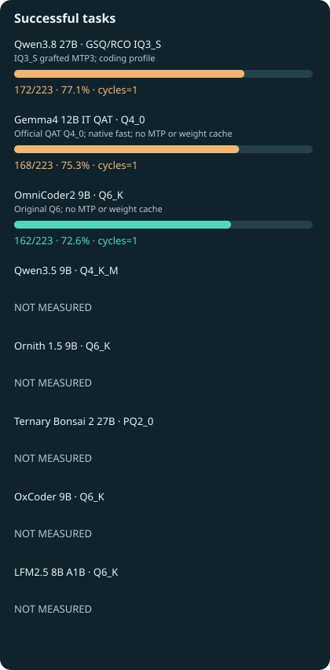{ .benchmark-svg }

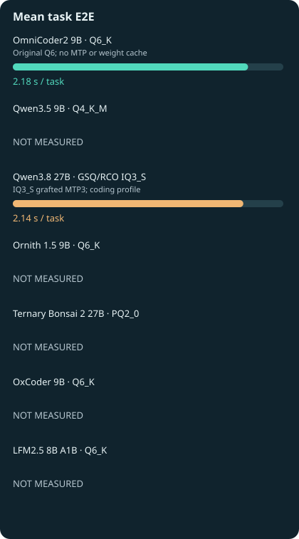{ .benchmark-svg }

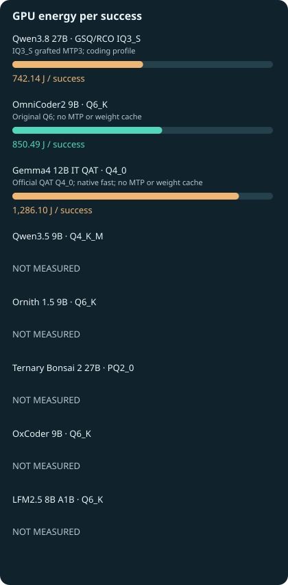{ .benchmark-svg }

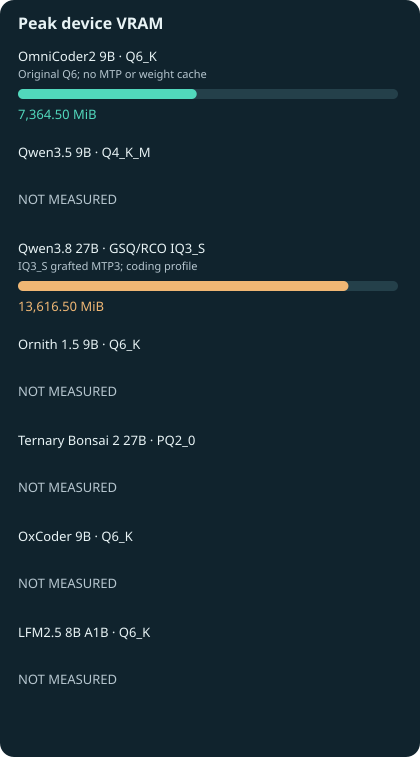{ .benchmark-svg }

| Profile / record date | Success | Successful tasks/s | Total task time / GPU energy | Peak VRAM | Audit |
|---|---|---|---|---|---|
| OmniCoder2 9B Q6_K — Original Q6; no MTP or weight cache / 2026-10-22 | 162/223 | 0.33264 | 487.010 s / 137779.71 J | 7364.5 | [R415](experiments/R415.md) |
| Qwen3.8 27B GSQ/RCO IQ3_S — IQ3_S grafted MTP3; coding profile / 2026-10-22 | 172/223 | 0.36041 | 477.232 s / 127647.53 J | 13616.5 | [R416](experiments/R416.md) |
| Gemma4 12B IT QAT Q4_0 — Official QAT Q4_0; native fast; no MTP or weight cache / 2026-10-22 | 168/223 | 0.19142 | 877.635 s / 216064.31 J | 8118.5 | [R428](experiments/R428.md) |

### OmniCoder2 9B · Q6_K · R415

Original Q6; no MTP or weight cache. No additional policy claim is inferred from this discipline.

| Condition | Audited value |
|---|---|
| Separate process-VRAM observation (not device peak) | NOT MEASURED |
| Hardware / power | Tesla V100-SXM2 16 GB HBM2 / 300 W |
| Engine | llama.cpp / CUDA 12.8 / SM70 (exact audited binary below) |
| Date | 2026-10-22 |
| Context, batching, KV, speculation | {"--batch-size": "2048", "--cache-type-k": "f16", "--cache-type-v": "f16", "--ctx-size": "8192", "--reasoning": "off", "--spec-type": "none", "--threads": "6", "--ubatch-size": "512"} |
| Sampling / output cap | {"seed": 1001, "temperature": 0.0} / 1024 |
| Cache / timing scope | Warm model; per-request KV reset; OS file cache uncontrolled; model startup excluded |
| Measurement batches | R411:32 + R415:191, disjoint tasks; no repeats |
| Actual template controls | {"enable_thinking": false} |
| Actual input-token range (if exported) | Not included in this public aggregate |
| Task count / repeats | 223 unique; one observed answer per task; no repeated-run uncertainty measured |
| Model SHA-256 | b0c1664c86338be24090a45d8b86bd106ba755d004f8746d99ee5ad69258fc3b |
| Engine binary SHA-256 | 08827111e1b856c38d7a3a46ef2d33b36f201d3de76afdf4ac60f061c97fce54 |
| Template SHA-256 | a4aee8afcf2e0711942cf848899be66016f8d14a889ff9ede07bca099c28f715 |
| Scorer adapter SHA-256 | 1b044c31ebf9fa65aff9540afb50ab5e756af65cf464afcc78770131a76728d7 |
| EvalPlus provenance SHA-256 | Not applicable / not duplicated |
| Plan SHA-256 | bb595974d3f8a74077f6a350a967ceb402990061100ef6dd50582af3cf0ef473 |

Original audit SHA-256 (originals retained privately; public excerpts are not the original files):

- [audit-e65387abe0a60505cf31](audits/audit-e65387abe0a60505cf31.md): `e65387abe0a60505cf31669aea4e05193eedd2c7f472eeff8312200123cae6c2`
- [audit-c3eda7245a81d8aea7e7](audits/audit-c3eda7245a81d8aea7e7.md): `c3eda7245a81d8aea7e7503a0109288e7ee02de2efccda32d9e545050d32393b`
- [audit-779c649d0c7aedb3a542](audits/audit-779c649d0c7aedb3a542.md): `779c649d0c7aedb3a54236109c23f8c25787ab480e2a63639400a12146f208ec`
- [audit-7fc79c331d1e88062f8a](audits/audit-7fc79c331d1e88062f8a.md): `7fc79c331d1e88062f8a749a024abca4577d945eae39de2ba8b6991f388d90c4`
- [audit-e65387abe0a60505cf31](audits/audit-e65387abe0a60505cf31.md): `e65387abe0a60505cf31669aea4e05193eedd2c7f472eeff8312200123cae6c2`

### Qwen3.8 27B · GSQ/RCO IQ3_S · R416

IQ3_S grafted MTP3; coding profile. Known native-tool/policy limitations remain; coding only, no allround or lossless claim.

| Condition | Audited value |
|---|---|
| Separate process-VRAM observation (not device peak) | NOT MEASURED |
| Hardware / power | Tesla V100-SXM2 16 GB HBM2 / 300 W |
| Engine | llama.cpp / CUDA 12.8 / SM70 (exact audited binary below) |
| Date | 2026-10-22 |
| Context, batching, KV, speculation | {"--batch-size": "2048", "--cache-type-k": "f16", "--cache-type-v": "f16", "--ctx-size": "8192", "--reasoning": "off", "--spec-draft-n-max": "3", "--spec-type": "draft-mtp", "--threads": "6", "--ubatch-size": "512"} |
| Sampling / output cap | {"seed": 1001, "temperature": 0.0} / 1024 |
| Cache / timing scope | Warm model; per-request KV reset; OS file cache uncontrolled; model startup excluded |
| Measurement batches | R413:32 + R416:191, disjoint tasks; no repeats |
| Actual template controls | {"enable_thinking": false} |
| Actual input-token range (if exported) | Not included in this public aggregate |
| Task count / repeats | 223 unique; one observed answer per task; no repeated-run uncertainty measured |
| Model SHA-256 | 58fd826723939933dc86f45b7fe04545cbc2de1c70f6fe2cdd3858c87a98c12f |
| Engine binary SHA-256 | 08827111e1b856c38d7a3a46ef2d33b36f201d3de76afdf4ac60f061c97fce54 |
| Template SHA-256 | c3cf9e34abf4f9e36c2d72165aa9c132d3e2a725b6c2586aaa3a8af9d7a81041 |
| Scorer adapter SHA-256 | 1b044c31ebf9fa65aff9540afb50ab5e756af65cf464afcc78770131a76728d7 |
| EvalPlus provenance SHA-256 | Not applicable / not duplicated |
| Plan SHA-256 | ad7af282e525daf3a4b2fc1cdb71a37021cf347d0bd0d22d8bcd90a4998ac003 |

Original audit SHA-256 (originals retained privately; public excerpts are not the original files):

- [audit-48622d74f74d1c3f7630](audits/audit-48622d74f74d1c3f7630.md): `48622d74f74d1c3f76300417b6a167b884bb86d11ba1255a135a6e448b0ac8f0`
- [audit-066a121f6734b7aaf3d8](audits/audit-066a121f6734b7aaf3d8.md): `066a121f6734b7aaf3d87b38f43ecddb7d6b51c6a5cda5982b323d6b93a57dce`
- [audit-84dc3818048e9e8fb943](audits/audit-84dc3818048e9e8fb943.md): `84dc3818048e9e8fb9435aa06e7f5000b3e8e60d8c1daeab49f3e934440d4a78`
- [audit-12a7d0b17bab09967917](audits/audit-12a7d0b17bab09967917.md): `12a7d0b17bab09967917bafee75b68d3b4baa81550f298602c406d56b4e7f05a`
- [audit-48622d74f74d1c3f7630](audits/audit-48622d74f74d1c3f7630.md): `48622d74f74d1c3f76300417b6a167b884bb86d11ba1255a135a6e448b0ac8f0`

### Gemma4 12B IT QAT · Q4_0 · R428

Official QAT Q4_0; native fast; no MTP or weight cache. Native-tool84/100 and agent9/18 with additional policy faults retained; coding results do not qualify an assistant.

| Condition | Audited value |
|---|---|
| Separate process-VRAM observation (not device peak) | NOT MEASURED |
| Hardware / power | Tesla V100-SXM2 16 GB HBM2 / 300 W |
| Engine | llama.cpp / CUDA 12.8 / SM70 (exact audited binary below) |
| Date | 2026-10-22 |
| Context, batching, KV, speculation | {"--batch-size": "2048", "--cache-type-k": "f16", "--cache-type-v": "f16", "--ctx-size": "8192", "--reasoning": "off", "--spec-type": "none", "--threads": "6", "--ubatch-size": "512"} |
| Sampling / output cap | {"min_p": 0.0, "presence_penalty": 0.0, "repeat_penalty": 1.0, "seed": 1001, "temperature": 1.0, "top_k": 64, "top_p": 0.95} / 1024 |
| Cache / timing scope | Warm model; per-request KV reset; OS file cache uncontrolled; model startup excluded |
| Measurement batches | R427:32 + R428:191, disjoint tasks; no repeats |
| Actual template controls | {"enable_thinking": false} |
| Actual input-token range (if exported) | Not included in this public aggregate |
| Task count / repeats | 223 unique; one observed answer per task; no repeated-run uncertainty measured |
| Model SHA-256 | 93567e57a8fe10b23569b9d9ec38cd005deedf71e29477c421a4b83f418a538b |
| Engine binary SHA-256 | 08827111e1b856c38d7a3a46ef2d33b36f201d3de76afdf4ac60f061c97fce54 |
| Template SHA-256 | ae53464bf3be25802b3a5b37def7fd89667067d7577049b3b2d74c4d8de4c6d4 |
| Scorer adapter SHA-256 | 1b044c31ebf9fa65aff9540afb50ab5e756af65cf464afcc78770131a76728d7 |
| EvalPlus provenance SHA-256 | Not applicable / not duplicated |
| Plan SHA-256 | 6e9646206b88a6d093d60ea2d1e163ad71247f87d33dadcc3ac61f792749ab67 |

Original audit SHA-256 (originals retained privately; public excerpts are not the original files):

- [audit-a496d811bed11b4d3351](audits/audit-a496d811bed11b4d3351.md): `a496d811bed11b4d3351353f73538f1922ff39dfdaef39e2c8e23f0f4850dd9f`
- [audit-1b31ba0c1159d8d3f3cd](audits/audit-1b31ba0c1159d8d3f3cd.md): `1b31ba0c1159d8d3f3cd1f3ff75c30157616d2ed5cd192f1ee9c4f39388c6401`
- [audit-f19c98d28f6d0f2baf73](audits/audit-f19c98d28f6d0f2baf73.md): `f19c98d28f6d0f2baf7356728309b91b1e04a95a5555932392d7e6fcb26c36d0`
- [audit-ff32d141eb26b6f4d1eb](audits/audit-ff32d141eb26b6f4d1eb.md): `ff32d141eb26b6f4d1ebb3cbc94ff906b85dba3b0e43657d9dc4e46822710c42`
- [audit-a496d811bed11b4d3351](audits/audit-a496d811bed11b4d3351.md): `a496d811bed11b4d3351353f73538f1922ff39dfdaef39e2c8e23f0f4850dd9f`

## Native Tools · balanced 100

Frozen balanced native-tool subset: 100 cases, 20 in each of five categories; official AST plus irrelevance rules; not full BFCL leaderboard.

Task identity: `7c273de654cb6f5dec4dacb5d65b1ea8cd236c8dac9ba674ecfed21e292b8698`. **Task-matched whole-configuration comparisons**; native sampling, budgets and builds are shown below. These are development results, with no repeated-seed model-superiority claim. Record dates come from the original audit or frozen plan; missing dates remain labelled.

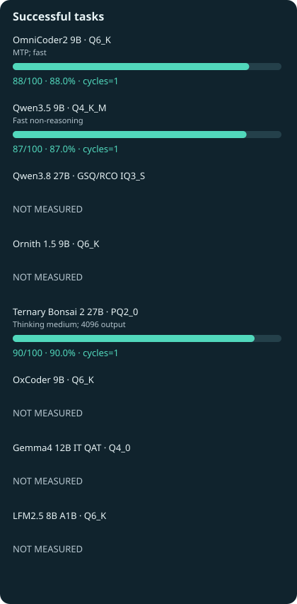{ .benchmark-svg }

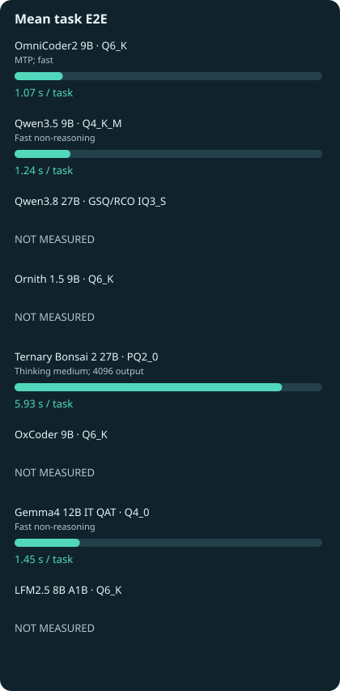{ .benchmark-svg }

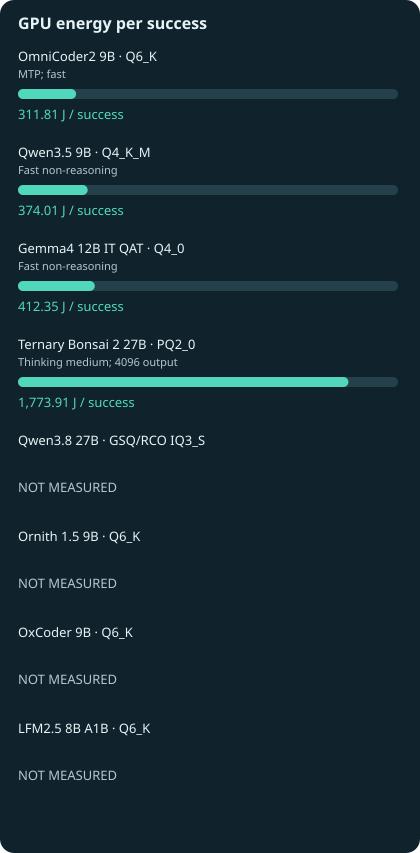{ .benchmark-svg }

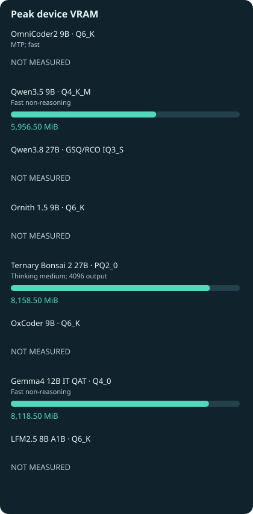{ .benchmark-svg }

| Profile / record date | Success | Successful tasks/s | Total task time / GPU energy | Peak VRAM | Audit |
|---|---|---|---|---|---|
| OmniCoder2 9B Q6_K — MTP; fast / NOT RECORDED | 88/100 | 0.82237 | 107.007 s / 27438.98 J | NOT MEASURED | [R183](experiments/R183.md) |
| Qwen3.5 9B Q4_K_M — Fast non-reasoning / 2026-10-20 | 87/100 | 0.70201 | 123.930 s / 32539.27 J | 5956.5 | [R227](experiments/R227.md) |
| Gemma4 12B IT QAT Q4_0 — Fast non-reasoning / 2026-10-22 | 84/100 | 0.58041 | 144.726 s / 34637.24 J | 8118.5 | [R424](experiments/R424.md) |
| Ternary Bonsai 2 27B PQ2_0 — Thinking medium; 4096 output / 2026-10-21 | 90/100 | 0.15166 | 593.425 s / 159652.16 J | 8158.5 | [R281](experiments/R281.md) |

### OmniCoder2 9B · Q6_K · R183

MTP; fast. No additional policy claim is inferred from this discipline.

| Condition | Audited value |
|---|---|
| Separate process-VRAM observation (not device peak) | 8758 |
| Hardware / power | Tesla V100-SXM2 16 GB HBM2 / 300 W |
| Engine | llama.cpp / CUDA 12.8 / SM70 (exact audited binary below) |
| Date | NOT RECORDED |
| Context, batching, KV, speculation | {"batch_size": 2048, "cache_prompt": false, "ctx": 8192, "seed": 1001, "slots": 1, "temperature": 0, "thinking": false, "threads": 6, "ubatch_size": 512} |
| Sampling / output cap | {"seed": 1001, "temperature": 0} / 1024 |
| Cache / timing scope | Warm model; per-request KV reset; OS file cache uncontrolled; model startup excluded |
| Measurement batches | Single suite or repeated cycles as stated |
| Actual template controls | See pinned native request evidence |
| Actual input-token range (if exported) | Not included in this public aggregate |
| Task count / repeats | 100 unique; one observed answer per task; no repeated-run uncertainty measured |
| Model SHA-256 | b0c1664c86338be24090a45d8b86bd106ba755d004f8746d99ee5ad69258fc3b |
| Engine binary SHA-256 | 08827111e1b856c38d7a3a46ef2d33b36f201d3de76afdf4ac60f061c97fce54 |
| Template SHA-256 | a4aee8afcf2e0711942cf848899be66016f8d14a889ff9ede07bca099c28f715 |
| Scorer adapter SHA-256 | 55290a596d5e49a066e58ba5ce3cc6c204520e730078e27abc4f50831782678d |
| EvalPlus provenance SHA-256 | Not applicable / not duplicated |
| Plan SHA-256 | 3de468fe73193dd6faa10bf982d9b022be06f1018d587b50399e03f1a88efd55 |

Original audit SHA-256 (originals retained privately; public excerpts are not the original files):

- [audit-74d034ef6a5873b4a5e9](audits/audit-74d034ef6a5873b4a5e9.md): `74d034ef6a5873b4a5e96b0fef4f39dcf84706bad9ee7d1baa3800b4dd7cefc2`

### Qwen3.5 9B · Q4_K_M · R227

Fast non-reasoning. No additional policy claim is inferred from this discipline.

| Condition | Audited value |
|---|---|
| Separate process-VRAM observation (not device peak) | NOT MEASURED |
| Hardware / power | Tesla V100-SXM2 16 GB HBM2 / 300 W |
| Engine | llama.cpp / CUDA 12.8 / SM70 (exact audited binary below) |
| Date | 2026-10-20 |
| Context, batching, KV, speculation | {"--batch-size": "2048", "--cache-type-k": "f16", "--cache-type-v": "f16", "--ctx-size": "8192", "--reasoning": "off", "--threads": "6", "--ubatch-size": "512"} |
| Sampling / output cap | {"seed": 1001, "temperature": 0} / NOT RECORDED |
| Cache / timing scope | Warm model; per-request KV reset; OS file cache uncontrolled; model startup excluded |
| Measurement batches | Single suite or repeated cycles as stated |
| Actual template controls | See pinned native request evidence |
| Actual input-token range (if exported) | Not included in this public aggregate |
| Task count / repeats | 100 unique; one observed answer per task; no repeated-run uncertainty measured |
| Model SHA-256 | 02d45dc1cf451ba2475ac33b301c2dd8f985abe4c182ce04a1f2f5bf0260278d |
| Engine binary SHA-256 | 08827111e1b856c38d7a3a46ef2d33b36f201d3de76afdf4ac60f061c97fce54 |
| Template SHA-256 | a4aee8afcf2e0711942cf848899be66016f8d14a889ff9ede07bca099c28f715 |
| Scorer adapter SHA-256 | 55290a596d5e49a066e58ba5ce3cc6c204520e730078e27abc4f50831782678d |
| EvalPlus provenance SHA-256 | 332b4dfcdd92cb653859dd392c9e2430726aa85cc6560dcfc76282d06310e64d |
| Plan SHA-256 | 04cef369fdba9073bd68111484d2163709a381f4b79e610da049aec1a5a9b887 |

Original audit SHA-256 (originals retained privately; public excerpts are not the original files):

- [audit-3282effcb0cfa011c3fa](audits/audit-3282effcb0cfa011c3fa.md): `3282effcb0cfa011c3fa3df749c6a84d28051aaebad9d1b286031a3190c7df83`

### Gemma4 12B IT QAT · Q4_0 · R424

Fast non-reasoning. No additional policy claim is inferred from this discipline.

| Condition | Audited value |
|---|---|
| Separate process-VRAM observation (not device peak) | NOT MEASURED |
| Hardware / power | Tesla V100-SXM2 16 GB HBM2 / 300 W |
| Engine | llama.cpp / CUDA 12.8 / SM70 (exact audited binary below) |
| Date | 2026-10-22 |
| Context, batching, KV, speculation | {"--batch-size": "2048", "--cache-type-k": "f16", "--cache-type-v": "f16", "--ctx-size": "8192", "--reasoning": "off", "--spec-type": "none", "--threads": "6", "--ubatch-size": "512"} |
| Sampling / output cap | {"min_p": 0.0, "presence_penalty": 0.0, "repeat_penalty": 1.0, "seed": 1001, "temperature": 1.0, "top_k": 64, "top_p": 0.95} / 1024 |
| Cache / timing scope | Warm model; per-request KV reset; OS file cache uncontrolled; model startup excluded |
| Measurement batches | Single suite or repeated cycles as stated |
| Actual template controls | See pinned native request evidence |
| Actual input-token range (if exported) | Not included in this public aggregate |
| Task count / repeats | 100 unique; one observed answer per task; no repeated-run uncertainty measured |
| Model SHA-256 | 93567e57a8fe10b23569b9d9ec38cd005deedf71e29477c421a4b83f418a538b |
| Engine binary SHA-256 | 08827111e1b856c38d7a3a46ef2d33b36f201d3de76afdf4ac60f061c97fce54 |
| Template SHA-256 | ae53464bf3be25802b3a5b37def7fd89667067d7577049b3b2d74c4d8de4c6d4 |
| Scorer adapter SHA-256 | 55290a596d5e49a066e58ba5ce3cc6c204520e730078e27abc4f50831782678d |
| EvalPlus provenance SHA-256 | 332b4dfcdd92cb653859dd392c9e2430726aa85cc6560dcfc76282d06310e64d |
| Plan SHA-256 | fb0bbe31323fc9bb761a901bca0bcdae8ce43d729dddee41acd188784f4a979e |

Original audit SHA-256 (originals retained privately; public excerpts are not the original files):

- [audit-45e2cae381364ba4f29f](audits/audit-45e2cae381364ba4f29f.md): `45e2cae381364ba4f29f2c96e7d010d2eb28b3bc53eb87de4b5f31a2910c2011`

### Ternary Bonsai 2 27B · PQ2_0 · R281

Thinking medium; 4096 output. No additional policy claim is inferred from this discipline.

| Condition | Audited value |
|---|---|
| Separate process-VRAM observation (not device peak) | NOT MEASURED |
| Hardware / power | Tesla V100-SXM2 16 GB HBM2 / 300 W |
| Engine | llama.cpp / CUDA 12.8 / SM70 (exact audited binary below) |
| Date | 2026-10-21 |
| Context, batching, KV, speculation | {"--batch-size": "2048", "--cache-type-k": "f16", "--cache-type-v": "f16", "--ctx-size": "8192", "--reasoning": "on", "--spec-type": "none", "--threads": "6", "--ubatch-size": "512"} |
| Sampling / output cap | {"min_p": 0.05, "presence_penalty": 0.0, "repeat_penalty": 1.0, "seed": 1001, "temperature": 1.0, "top_k": 20, "top_p": 0.95} / 4096 |
| Cache / timing scope | Warm model; per-request KV reset; OS file cache uncontrolled; model startup excluded |
| Measurement batches | Single suite or repeated cycles as stated |
| Actual template controls | See pinned native request evidence |
| Actual input-token range (if exported) | Not included in this public aggregate |
| Task count / repeats | 100 unique; one observed answer per task; no repeated-run uncertainty measured |
| Model SHA-256 | 3907dc1658db1f78a9826bf8d5bcb8dc65db0d466388937af57f2294fae62ec1 |
| Engine binary SHA-256 | 94c60d4646249fe067c75a56b15e6a8a9070a5e422cae16ee8dd9973389a6a27 |
| Template SHA-256 | See exact plan audit; not duplicated in public subset |
| Scorer adapter SHA-256 | b0c619f7f1022b4c06c18ba6c6e608006e1609b667ed0d90a399f906afd2c2a5 |
| EvalPlus provenance SHA-256 | Not applicable / not duplicated |
| Plan SHA-256 | c47c5993a526d67abb70d1cba56e1d9741cd82cb89ced1f488c179f7d5566555 |

Original audit SHA-256 (originals retained privately; public excerpts are not the original files):

- [audit-66c5bf1378a74271d1b1](audits/audit-66c5bf1378a74271d1b1.md): `66c5bf1378a74271d1b1ac12af19cd2490388f09906312cec02483605e71a1c3`
- [audit-6ba69d79b075c99f03ac](audits/audit-6ba69d79b075c99f03ac.md): `6ba69d79b075c99f03acc9d8dd5e343d27771106cebbbdbc0c6a0629a73e868f`
- [audit-c1f01d3d15d56ff49206](audits/audit-c1f01d3d15d56ff49206.md): `c1f01d3d15d56ff49206bcb86e1c8b925163c79ce3e41c61794fb7a490826981`

## Agents · isolated 18

Frozen 18 development agent tasks with unchanged effect/policy simulator; all tools isolated; not a new holdout.

Task identity: `104b1abf22c5d6ea46d7d29e3186a3c540b39140cf4e1feadbec0ec6f871e186`. **Task-matched whole-configuration comparisons**; native sampling, budgets and builds are shown below. These are development results, with no repeated-seed model-superiority claim. Record dates come from the original audit or frozen plan; missing dates remain labelled.

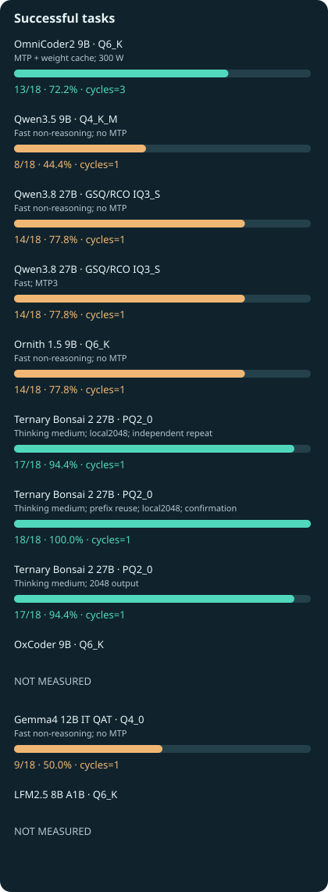{ .benchmark-svg }

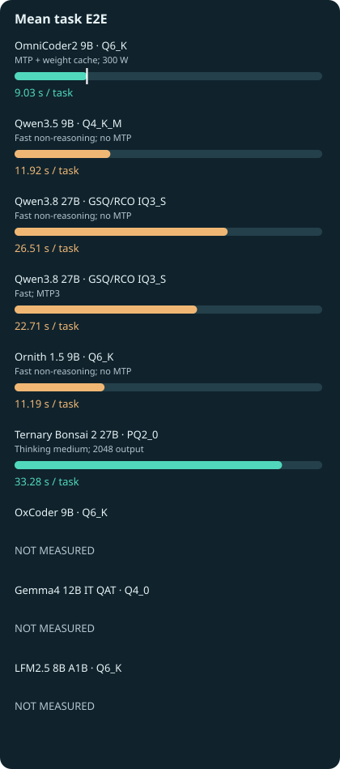{ .benchmark-svg }

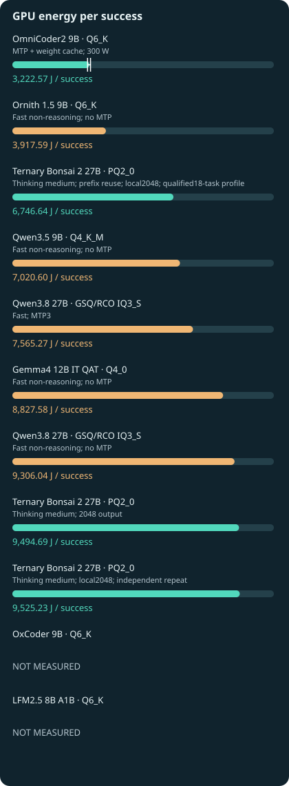{ .benchmark-svg }

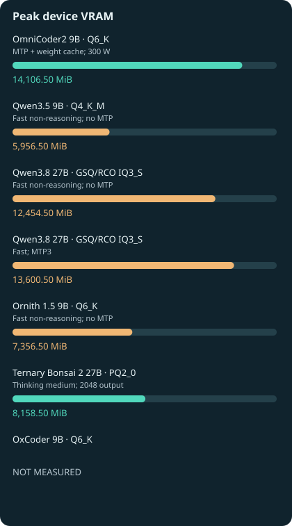{ .benchmark-svg }

| Profile / record date | Success | Successful tasks/s | Total task time / GPU energy | Peak VRAM | Audit |
|---|---|---|---|---|---|
| Qwen3.5 9B Q4_K_M — Fast non-reasoning; no MTP / 2026-10-20 | 8/18 | 0.03729 | 214.550 s / 56164.79 J | 5956.5 | [R228](experiments/R228.md) |
| Ornith 1.5 9B Q6_K — Fast non-reasoning; no MTP / 2026-10-20 | 14/18 | 0.06949 | 201.470 s / 54846.31 J | 7356.5 | [R253](experiments/R253.md) |
| Qwen3.8 27B GSQ/RCO IQ3_S — Fast non-reasoning; no MTP / 2026-10-20 | 14/18 | 0.02934 | 477.196 s / 130284.60 J | 12454.5 | [R260](experiments/R260.md) |
| Gemma4 12B IT QAT Q4_0 — Fast non-reasoning; no MTP / 2026-10-22 | 9/18 | 0.02778 | 323.942 s / 79448.26 J | 8118.5 | [R426](experiments/R426.md) |
| Ternary Bonsai 2 27B PQ2_0 — Thinking medium; local2048; independent repeat / 2026-10-22 | 17/18 | 0.02835 | 599.644 s / 161928.85 J | 8158.5 | [R440](experiments/R440.md) |
| Ternary Bonsai 2 27B PQ2_0 — Thinking medium; prefix reuse; local2048; confirmation / 2026-10-22 | 18/18 | 0.03945 | 456.320 s / 121439.49 J | 8158.5 | [R442](experiments/R442.md) |
| Qwen3.8 27B GSQ/RCO IQ3_S — Fast; MTP3 / 2026-10-20 | 14/18 | 0.03425 | 408.702 s / 105913.80 J | 13600.5 | [R261](experiments/R261.md) |
| OmniCoder2 9B Q6_K — MTP + weight cache; 300 W / 2026-10-20 | 13/18 | 0.08002 | 162.465 s / 41893.39 J | 14106.5 | [R219](experiments/R219.md) |
| Ternary Bonsai 2 27B PQ2_0 — Thinking medium; 2048 output / 2026-10-21 | 17/18 | 0.02838 | 599.016 s / 161409.67 J | 8158.5 | [R286](experiments/R286.md) |

### Qwen3.5 9B · Q4_K_M · R228

Fast non-reasoning; no MTP. Additional policy violations observed; no assistant qualification

| Condition | Audited value |
|---|---|
| Separate process-VRAM observation (not device peak) | NOT MEASURED |
| Hardware / power | Tesla V100-SXM2 16 GB HBM2 / 300 W |
| Engine | llama.cpp / CUDA 12.8 / SM70 (exact audited binary below) |
| Date | 2026-10-20 |
| Context, batching, KV, speculation | {"--batch-size": "2048", "--cache-type-k": "f16", "--cache-type-v": "f16", "--ctx-size": "8192", "--reasoning": "off", "--threads": "6", "--ubatch-size": "512", "retain_prefix": false} |
| Sampling / output cap | {"seed": 1001, "temperature": 0} / 1400 |
| Cache / timing scope | Warm model; per-request KV reset; OS file cache uncontrolled; model startup excluded |
| Measurement batches | Single suite or repeated cycles as stated |
| Actual template controls | See pinned native request evidence |
| Actual input-token range (if exported) | Not included in this public aggregate |
| Task count / repeats | 18 unique; one observed answer per task; no repeated-run uncertainty measured |
| Model SHA-256 | 02d45dc1cf451ba2475ac33b301c2dd8f985abe4c182ce04a1f2f5bf0260278d |
| Engine binary SHA-256 | 08827111e1b856c38d7a3a46ef2d33b36f201d3de76afdf4ac60f061c97fce54 |
| Template SHA-256 | a4aee8afcf2e0711942cf848899be66016f8d14a889ff9ede07bca099c28f715 |
| Scorer adapter SHA-256 | See audit scoring contract |
| EvalPlus provenance SHA-256 | Not applicable / not duplicated |
| Plan SHA-256 | fa8712f46e5cc987775cecd5fe3662414cd31b252b614f51c550946f5f704cb1 |

Original audit SHA-256 (originals retained privately; public excerpts are not the original files):

- [audit-f48de8313838adc8b3b4](audits/audit-f48de8313838adc8b3b4.md): `f48de8313838adc8b3b4940143dd90a7822a1e350aca33f67feaafb6318cebf3`

### Ornith 1.5 9B · Q6_K · R253

Fast non-reasoning; no MTP. Additional policy violations observed; no assistant qualification

| Condition | Audited value |
|---|---|
| Separate process-VRAM observation (not device peak) | NOT MEASURED |
| Hardware / power | Tesla V100-SXM2 16 GB HBM2 / 300 W |
| Engine | llama.cpp / CUDA 12.8 / SM70 (exact audited binary below) |
| Date | 2026-10-20 |
| Context, batching, KV, speculation | {"--batch-size": "2048", "--cache-type-k": "f16", "--cache-type-v": "f16", "--ctx-size": "8192", "--reasoning": "off", "--spec-type": "none", "--threads": "6", "--ubatch-size": "512", "retain_prefix": false} |
| Sampling / output cap | {"seed": 1001, "temperature": 0} / 1400 |
| Cache / timing scope | Warm model; per-request KV reset; OS file cache uncontrolled; model startup excluded |
| Measurement batches | Single suite or repeated cycles as stated |
| Actual template controls | See pinned native request evidence |
| Actual input-token range (if exported) | Not included in this public aggregate |
| Task count / repeats | 18 unique; one observed answer per task; no repeated-run uncertainty measured |
| Model SHA-256 | b6f76e74f86245b3caee014b797c10dca931c4dfdaabfb134eab655f81e4154a |
| Engine binary SHA-256 | 08827111e1b856c38d7a3a46ef2d33b36f201d3de76afdf4ac60f061c97fce54 |
| Template SHA-256 | 9dd2fbd270feaa1fbef2d4f634d7887c9c506e3bde140f8e7351c8944e8fd235 |
| Scorer adapter SHA-256 | See audit scoring contract |
| EvalPlus provenance SHA-256 | Not applicable / not duplicated |
| Plan SHA-256 | 8c20cddbcc71524da3919ade5ca0fbcc4fa72816fd1db6853348f82ea1f5a950 |

Original audit SHA-256 (originals retained privately; public excerpts are not the original files):

- [audit-c35dd0584281950f1dfd](audits/audit-c35dd0584281950f1dfd.md): `c35dd0584281950f1dfd8c72d357463f0efe9b45c10a50d5eb631bbb91325a42`

### Qwen3.8 27B · GSQ/RCO IQ3_S · R260

Fast non-reasoning; no MTP. Additional policy violations observed; no assistant qualification

| Condition | Audited value |
|---|---|
| Separate process-VRAM observation (not device peak) | NOT MEASURED |
| Hardware / power | Tesla V100-SXM2 16 GB HBM2 / 300 W |
| Engine | llama.cpp / CUDA 12.8 / SM70 (exact audited binary below) |
| Date | 2026-10-20 |
| Context, batching, KV, speculation | {"--batch-size": "2048", "--cache-type-k": "f16", "--cache-type-v": "f16", "--ctx-size": "8192", "--reasoning": "off", "--spec-type": "none", "--threads": "6", "--ubatch-size": "512", "retain_prefix": false} |
| Sampling / output cap | {"seed": 1001, "temperature": 0} / 1400 |
| Cache / timing scope | Warm model; per-request KV reset; OS file cache uncontrolled; model startup excluded |
| Measurement batches | Single suite or repeated cycles as stated |
| Actual template controls | See pinned native request evidence |
| Actual input-token range (if exported) | Not included in this public aggregate |
| Task count / repeats | 18 unique; one observed answer per task; no repeated-run uncertainty measured |
| Model SHA-256 | 58fd826723939933dc86f45b7fe04545cbc2de1c70f6fe2cdd3858c87a98c12f |
| Engine binary SHA-256 | 08827111e1b856c38d7a3a46ef2d33b36f201d3de76afdf4ac60f061c97fce54 |
| Template SHA-256 | c3cf9e34abf4f9e36c2d72165aa9c132d3e2a725b6c2586aaa3a8af9d7a81041 |
| Scorer adapter SHA-256 | See audit scoring contract |
| EvalPlus provenance SHA-256 | Not applicable / not duplicated |
| Plan SHA-256 | fb28c2f2e80ced215af46c100f17c9f9c3192e629f3e5efde7683776967b278b |

Original audit SHA-256 (originals retained privately; public excerpts are not the original files):

- [audit-7ea265b5613fdf6bd79c](audits/audit-7ea265b5613fdf6bd79c.md): `7ea265b5613fdf6bd79c6760b4925284a8c3d434edace84ad822e0982651cf0d`

### Gemma4 12B IT QAT · Q4_0 · R426

Fast non-reasoning; no MTP. Additional policy violations observed; no assistant qualification

| Condition | Audited value |
|---|---|
| Separate process-VRAM observation (not device peak) | NOT MEASURED |
| Hardware / power | Tesla V100-SXM2 16 GB HBM2 / 300 W |
| Engine | llama.cpp / CUDA 12.8 / SM70 (exact audited binary below) |
| Date | 2026-10-22 |
| Context, batching, KV, speculation | {"--batch-size": "2048", "--cache-type-k": "f16", "--cache-type-v": "f16", "--ctx-size": "8192", "--reasoning": "off", "--spec-type": "none", "--threads": "6", "--ubatch-size": "512", "retain_prefix": false} |
| Sampling / output cap | {"min_p": 0.0, "presence_penalty": 0.0, "repeat_penalty": 1.0, "seed": 1001, "temperature": 1.0, "top_k": 64, "top_p": 0.95} / 1400 |
| Cache / timing scope | Warm model; per-request KV reset; OS file cache uncontrolled; model startup excluded |
| Measurement batches | Single suite or repeated cycles as stated |
| Actual template controls | See pinned native request evidence |
| Actual input-token range (if exported) | Not included in this public aggregate |
| Task count / repeats | 18 unique; one observed answer per task; no repeated-run uncertainty measured |
| Model SHA-256 | 93567e57a8fe10b23569b9d9ec38cd005deedf71e29477c421a4b83f418a538b |
| Engine binary SHA-256 | 08827111e1b856c38d7a3a46ef2d33b36f201d3de76afdf4ac60f061c97fce54 |
| Template SHA-256 | ae53464bf3be25802b3a5b37def7fd89667067d7577049b3b2d74c4d8de4c6d4 |
| Scorer adapter SHA-256 | See audit scoring contract |
| EvalPlus provenance SHA-256 | Not applicable / not duplicated |
| Plan SHA-256 | bc06f49a06e3fa99d8cc16a1f3c8e91dc2f4ba6aa60405198febff6dd0244d94 |

Original audit SHA-256 (originals retained privately; public excerpts are not the original files):

- [audit-021cfb8ba15cb4471b11](audits/audit-021cfb8ba15cb4471b11.md): `021cfb8ba15cb4471b111ebcbe44088d2d26d06809f01981d24db6cde1b6f4a5`

### Ternary Bonsai 2 27B · PQ2_0 · R440

Thinking medium; local2048; independent repeat. No additional policy claim is inferred from this discipline.

| Condition | Audited value |
|---|---|
| Separate process-VRAM observation (not device peak) | NOT MEASURED |
| Hardware / power | Tesla V100-SXM2 16 GB HBM2 / 300 W |
| Engine | llama.cpp / CUDA 12.8 / SM70 (exact audited binary below) |
| Date | 2026-10-22 |
| Context, batching, KV, speculation | {"--batch-size": "2048", "--cache-type-k": "f16", "--cache-type-v": "f16", "--ctx-size": "8192", "--reasoning": "on", "--spec-type": "none", "--threads": "6", "--ubatch-size": "512", "retain_prefix": false} |
| Sampling / output cap | {"min_p": 0.05, "presence_penalty": 0.0, "repeat_penalty": 1.0, "temperature": 1.0, "top_k": 20, "top_p": 0.95} / 2048 |
| Cache / timing scope | Warm model; per-request KV reset; OS file cache uncontrolled; model startup excluded |
| Measurement batches | R440:one fresh18-case repeat of the same development tasks; not a newholdout or36independent tasks |
| Actual template controls | See pinned native request evidence |
| Actual input-token range (if exported) | Not included in this public aggregate |
| Task count / repeats | 18 unique; one observed answer per task; no repeated-run uncertainty measured |
| Model SHA-256 | 3907dc1658db1f78a9826bf8d5bcb8dc65db0d466388937af57f2294fae62ec1 |
| Engine binary SHA-256 | 94c60d4646249fe067c75a56b15e6a8a9070a5e422cae16ee8dd9973389a6a27 |
| Template SHA-256 | See exact plan audit; not duplicated in public subset |
| Scorer adapter SHA-256 | See audit scoring contract |
| EvalPlus provenance SHA-256 | Not applicable / not duplicated |
| Plan SHA-256 | b10a050b49051f92a3a8fcd6960005e56e2a42ced50b6b081e0718d74f44760f |

Original audit SHA-256 (originals retained privately; public excerpts are not the original files):

- [audit-f4df3d5aa78011e3584d](audits/audit-f4df3d5aa78011e3584d.md): `f4df3d5aa78011e3584d3639348b5135ed9accc95661823a349cffc8480e018c`

### Ternary Bonsai 2 27B · PQ2_0 · R442

Thinking medium; prefix reuse; local2048; confirmation. No additional policy claim is inferred from this discipline.

| Condition | Audited value |
|---|---|
| Separate process-VRAM observation (not device peak) | NOT MEASURED |
| Hardware / power | Tesla V100-SXM2 16 GB HBM2 / 300 W |
| Engine | llama.cpp / CUDA 12.8 / SM70 (exact audited binary below) |
| Date | 2026-10-22 |
| Context, batching, KV, speculation | {"--batch-size": "2048", "--cache-type-k": "f16", "--cache-type-v": "f16", "--ctx-size": "8192", "--reasoning": "on", "--spec-type": "none", "--threads": "6", "--ubatch-size": "512", "retain_prefix": true} |
| Sampling / output cap | {"min_p": 0.05, "presence_penalty": 0.0, "repeat_penalty": 1.0, "temperature": 1.0, "top_k": 20, "top_p": 0.95} / 2048 |
| Cache / timing scope | Warm model; firstturn resets eachcase, laterturns retainprefix in one slot; OSfilecache uncontrolled, startup/warmupexcluded |
| Measurement batches | R442:one full18-case prefixcandidate confirmation; no independentChampion fromfirst3screen |
| Actual template controls | See pinned native request evidence |
| Actual input-token range (if exported) | Not included in this public aggregate |
| Task count / repeats | 18 unique; one observed answer per task; no repeated-run uncertainty measured |
| Model SHA-256 | 3907dc1658db1f78a9826bf8d5bcb8dc65db0d466388937af57f2294fae62ec1 |
| Engine binary SHA-256 | 94c60d4646249fe067c75a56b15e6a8a9070a5e422cae16ee8dd9973389a6a27 |
| Template SHA-256 | See exact plan audit; not duplicated in public subset |
| Scorer adapter SHA-256 | See audit scoring contract |
| EvalPlus provenance SHA-256 | Not applicable / not duplicated |
| Plan SHA-256 | 1683005b2a201069d0d3de6e0984cdcd7fcf213463ea2f63914d7350bc8135f0 |

Original audit SHA-256 (originals retained privately; public excerpts are not the original files):

- [audit-a0726ce1921a21ae1360](audits/audit-a0726ce1921a21ae1360.md): `a0726ce1921a21ae13604536c04208d97a1d36cbe33230120b39b854d9f3f1ed`

### Qwen3.8 27B · GSQ/RCO IQ3_S · R261

Fast; MTP3. Additional policy failure inherited; coding-specialist screen, no general assistant qualification

| Condition | Audited value |
|---|---|
| Separate process-VRAM observation (not device peak) | NOT MEASURED |
| Hardware / power | Tesla V100-SXM2 16 GB HBM2 / 300 W |
| Engine | llama.cpp / CUDA 12.8 / SM70 (exact audited binary below) |
| Date | 2026-10-20 |
| Context, batching, KV, speculation | {"--batch-size": "2048", "--cache-type-k": "f16", "--cache-type-v": "f16", "--ctx-size": "8192", "--reasoning": "off", "--spec-draft-n-max": "3", "--spec-type": "draft-mtp", "--threads": "6", "--ubatch-size": "512", "retain_prefix": false} |
| Sampling / output cap | {"seed": 1001, "temperature": 0} / 1400 |
| Cache / timing scope | Warm model; per-request KV reset; OS file cache uncontrolled; model startup excluded |
| Measurement batches | Single suite or repeated cycles as stated |
| Actual template controls | See pinned native request evidence |
| Actual input-token range (if exported) | Not included in this public aggregate |
| Task count / repeats | 18 unique; one observed answer per task; no repeated-run uncertainty measured |
| Model SHA-256 | 58fd826723939933dc86f45b7fe04545cbc2de1c70f6fe2cdd3858c87a98c12f |
| Engine binary SHA-256 | 08827111e1b856c38d7a3a46ef2d33b36f201d3de76afdf4ac60f061c97fce54 |
| Template SHA-256 | c3cf9e34abf4f9e36c2d72165aa9c132d3e2a725b6c2586aaa3a8af9d7a81041 |
| Scorer adapter SHA-256 | See audit scoring contract |
| EvalPlus provenance SHA-256 | Not applicable / not duplicated |
| Plan SHA-256 | c78e3a0d6960cf2c19c584789ec4ebcd6b1535ae3a38ce87b065061897d562d1 |

Original audit SHA-256 (originals retained privately; public excerpts are not the original files):

- [audit-87f6ea8a70d72917e748](audits/audit-87f6ea8a70d72917e748.md): `87f6ea8a70d72917e7486912fe5b5201c8e9b68d21d020ec6a698c3b54f3b43e`

### OmniCoder2 9B · Q6_K · R219

MTP + weight cache; 300 W. No additional policy claim is inferred from this discipline.

| Condition | Audited value |
|---|---|
| Separate process-VRAM observation (not device peak) | NOT MEASURED |
| Hardware / power | Tesla V100-SXM2 16 GB HBM2 / 300 W |
| Engine | llama.cpp / CUDA 12.8 / SM70 (exact audited binary below) |
| Date | 2026-10-20 |
| Context, batching, KV, speculation | {"--batch-size": "2048", "--cache-type-k": "f16", "--cache-type-v": "f16", "--ctx-size": "8192", "--reasoning": "off", "--spec-draft-n-max": "3", "--spec-type": "draft-mtp", "--threads": "6", "--ubatch-size": "512", "retain_prefix": false} |
| Sampling / output cap | {"seed": 1001, "temperature": 0} / 1400 |
| Cache / timing scope | Warm model; per-request KV reset; OS file cache uncontrolled; model startup excluded |
| Measurement batches | Single suite or repeated cycles as stated |
| Actual template controls | See pinned native request evidence |
| Actual input-token range (if exported) | Not included in this public aggregate |
| Task count / repeats | 18 unique; Observed min–max of three repeated 18-case cycle aggregates; not 54 independent tasks. |
| Model SHA-256 | b0c1664c86338be24090a45d8b86bd106ba755d004f8746d99ee5ad69258fc3b |
| Engine binary SHA-256 | 08827111e1b856c38d7a3a46ef2d33b36f201d3de76afdf4ac60f061c97fce54 |
| Template SHA-256 | a4aee8afcf2e0711942cf848899be66016f8d14a889ff9ede07bca099c28f715 |
| Scorer adapter SHA-256 | See audit scoring contract |
| EvalPlus provenance SHA-256 | Not applicable / not duplicated |
| Plan SHA-256 | 096e2b2496adec4ad1feee8e69d3db0d18aaba5990cf61961a074266ad29c5c7 |

Original audit SHA-256 (originals retained privately; public excerpts are not the original files):

- [audit-7c91d45dc1aa187fe880](audits/audit-7c91d45dc1aa187fe880.md): `7c91d45dc1aa187fe8800d41cca25dc34e52b817b7f974e3c8bb16bd2d59cc2a`
- [audit-9a720eae0135df096db9](audits/audit-9a720eae0135df096db9.md): `9a720eae0135df096db9e1b28bed9134ef98bc6aa4bd656dbd9b5e0d7328ccb3`

### Ternary Bonsai 2 27B · PQ2_0 · R286

Thinking medium; 2048 output. No additional policy claim is inferred from this discipline.

| Condition | Audited value |
|---|---|
| Separate process-VRAM observation (not device peak) | NOT MEASURED |
| Hardware / power | Tesla V100-SXM2 16 GB HBM2 / 300 W |
| Engine | llama.cpp / CUDA 12.8 / SM70 (exact audited binary below) |
| Date | 2026-10-21 |
| Context, batching, KV, speculation | {"--batch-size": "2048", "--cache-type-k": "f16", "--cache-type-v": "f16", "--ctx-size": "8192", "--reasoning": "on", "--spec-type": "none", "--threads": "6", "--ubatch-size": "512", "retain_prefix": false} |
| Sampling / output cap | {"min_p": 0.05, "presence_penalty": 0.0, "repeat_penalty": 1.0, "temperature": 1.0, "top_k": 20, "top_p": 0.95} / 2048 |
| Cache / timing scope | Warm model; per-request KV reset; OS file cache uncontrolled; model startup excluded |
| Measurement batches | R285:16 + R286:2 disjoint agent cases; R284 failed before agent generation and is excluded |
| Actual template controls | See pinned native request evidence |
| Actual input-token range (if exported) | Not included in this public aggregate |
| Task count / repeats | 18 unique; one observed answer per task; no repeated-run uncertainty measured |
| Model SHA-256 | 3907dc1658db1f78a9826bf8d5bcb8dc65db0d466388937af57f2294fae62ec1 |
| Engine binary SHA-256 | 94c60d4646249fe067c75a56b15e6a8a9070a5e422cae16ee8dd9973389a6a27 |
| Template SHA-256 | See exact plan audit; not duplicated in public subset |
| Scorer adapter SHA-256 | See audit scoring contract |
| EvalPlus provenance SHA-256 | Not applicable / not duplicated |
| Plan SHA-256 | fb5cfb88f5b1a44a1f6cb6ee15aa02d0fbae7b6e83e61f507feca5a69f67fefb |

Original audit SHA-256 (originals retained privately; public excerpts are not the original files):

- [audit-355f55bd44c49fb08916](audits/audit-355f55bd44c49fb08916.md): `355f55bd44c49fb089167f11e666581db3bf3c188d499a6104c2d897d5be04af`
- [audit-c654b84d0dcad4ee1544](audits/audit-c654b84d0dcad4ee1544.md): `c654b84d0dcad4ee15440f026387212919515eb04b65b8dbf152f4f3efd33485`
- [audit-b1fc6b9a04856cba1af0](audits/audit-b1fc6b9a04856cba1af0.md): `b1fc6b9a04856cba1af0acf96a90c9ec3f7dfdd9c15e919f3b73b53cfaea52aa`

## Long inventory · 16K profiles

Twelve identical frozen long-inventory texts and typed native-call oracles; context16384, output256. Same requests/scoring with own native model templates/tokenizers and T0 versus T1 sampling. Original Omni16K partial R339 is excluded from full12 bars; Omni32K R338 remains a separate context/protocol evidence record. No full BFCL or agent claim.

Task identity: `c2218e9d5a2e2cef411698f637add2cf76465c6f0766ef22de16d8b5c4840a83`. **Task-matched whole-configuration comparisons**; native sampling, budgets and builds are shown below. These are development results, with no repeated-seed model-superiority claim. Record dates come from the original audit or frozen plan; missing dates remain labelled.

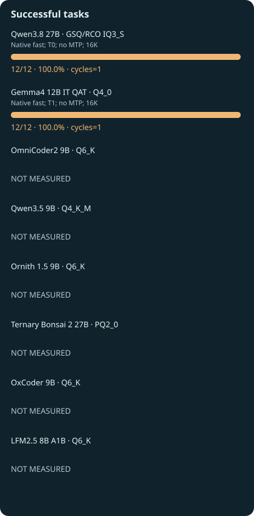{ .benchmark-svg }

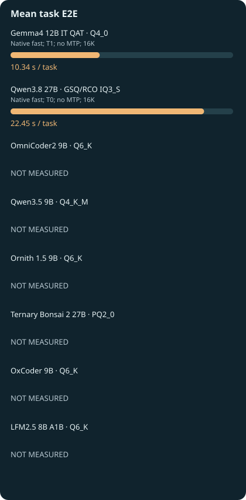{ .benchmark-svg }

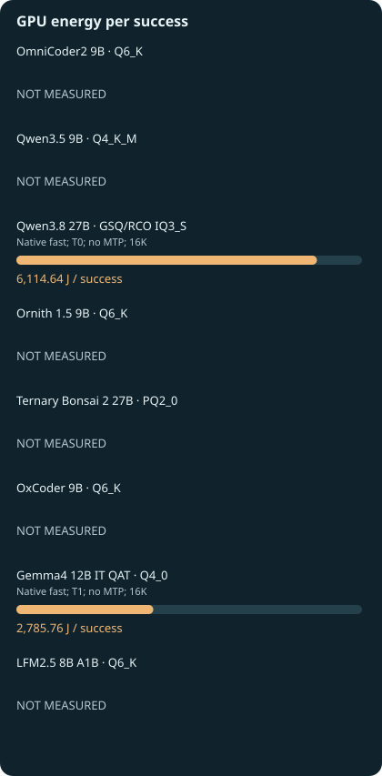{ .benchmark-svg }

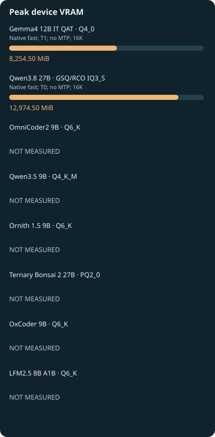{ .benchmark-svg }

| Profile / record date | Success | Successful tasks/s | Total task time / GPU energy | Peak VRAM | Audit |
|---|---|---|---|---|---|
| Gemma4 12B IT QAT Q4_0 — Native fast; T1; no MTP; 16K / 2026-10-22 | 12/12 | 0.09670 | 124.101 s / 33429.07 J | 8254.5 | [R429](experiments/R429.md) |
| Qwen3.8 27B GSQ/RCO IQ3_S — Native fast; T0; no MTP; 16K / 2026-10-22 | 12/12 | 0.04454 | 269.407 s / 73375.72 J | 12974.5 | [R432](experiments/R432.md) |

### Gemma4 12B IT QAT · Q4_0 · R429

Native fast; T1; no MTP; 16K. Separate agent-policy failures remain; this is read-only synthetic inventory retrieval, not agent or assistant qualification.

| Condition | Audited value |
|---|---|
| Separate process-VRAM observation (not device peak) | NOT MEASURED |
| Hardware / power | Tesla V100-SXM2 16 GB HBM2 / 300 W |
| Engine | llama.cpp / CUDA 12.8 / SM70 (exact audited binary below) |
| Date | 2026-10-22 |
| Context, batching, KV, speculation | {"--batch-size": "2048", "--cache-type-k": "f16", "--cache-type-v": "f16", "--ctx-size": "16384", "--reasoning": "off", "--spec-type": "none", "--threads": "6", "--ubatch-size": "512"} |
| Sampling / output cap | {"min_p": 0.0, "presence_penalty": 0.0, "repeat_penalty": 1.0, "seed": 1001, "temperature": 1.0, "top_k": 64, "top_p": 0.95} / 256 |
| Cache / timing scope | Warm model; per-request KV reset; OS file cache uncontrolled; model startup excluded |
| Measurement batches | Single suite or repeated cycles as stated |
| Actual template controls | {"enable_thinking": false} |
| Actual input-token range (if exported) | [14743, 14817] |
| Task count / repeats | 12 unique; one observed answer per task; no repeated-run uncertainty measured |
| Model SHA-256 | 93567e57a8fe10b23569b9d9ec38cd005deedf71e29477c421a4b83f418a538b |
| Engine binary SHA-256 | 08827111e1b856c38d7a3a46ef2d33b36f201d3de76afdf4ac60f061c97fce54 |
| Template SHA-256 | ae53464bf3be25802b3a5b37def7fd89667067d7577049b3b2d74c4d8de4c6d4 |
| Scorer adapter SHA-256 | 719e912326059cd85d3c0915afd648c631fd2841fd4f5ba0baa5831c5cf2e807 |
| EvalPlus provenance SHA-256 | Not applicable / not duplicated |
| Plan SHA-256 | d817683964a08b892be642f76a2acc2018d3fd5492915cafe48ab66574d6e6f1 |

Original audit SHA-256 (originals retained privately; public excerpts are not the original files):

- [audit-13697d6c2db1e7cf8ca9](audits/audit-13697d6c2db1e7cf8ca9.md): `13697d6c2db1e7cf8ca9b8da7d086f1e2069d7a1d354b506ebc1abd92a1c5fcb`
- [audit-7b1ef9844e4319cdb9a5](audits/audit-7b1ef9844e4319cdb9a5.md): `7b1ef9844e4319cdb9a5e1f367a92e3646329a4d1094a884621fba8d1b9a9c00`

### Qwen3.8 27B · GSQ/RCO IQ3_S · R432

Native fast; T0; no MTP; 16K. Separate agent-policy failures remain; this is read-only synthetic inventory retrieval, not agent or assistant qualification.

| Condition | Audited value |
|---|---|
| Separate process-VRAM observation (not device peak) | NOT MEASURED |
| Hardware / power | Tesla V100-SXM2 16 GB HBM2 / 300 W |
| Engine | llama.cpp / CUDA 12.8 / SM70 (exact audited binary below) |
| Date | 2026-10-22 |
| Context, batching, KV, speculation | {"--batch-size": "2048", "--cache-type-k": "f16", "--cache-type-v": "f16", "--ctx-size": "16384", "--reasoning": "off", "--spec-type": "none", "--threads": "6", "--ubatch-size": "512"} |
| Sampling / output cap | {"seed": 1001, "temperature": 0.0} / 256 |
| Cache / timing scope | Warm model; per-request KV reset; OS file cache uncontrolled; model startup excluded |
| Measurement batches | Single suite or repeated cycles as stated |
| Actual template controls | {"enable_thinking": false} |
| Actual input-token range (if exported) | [14003, 14066] |
| Task count / repeats | 12 unique; one observed answer per task; no repeated-run uncertainty measured |
| Model SHA-256 | 58fd826723939933dc86f45b7fe04545cbc2de1c70f6fe2cdd3858c87a98c12f |
| Engine binary SHA-256 | 08827111e1b856c38d7a3a46ef2d33b36f201d3de76afdf4ac60f061c97fce54 |
| Template SHA-256 | c3cf9e34abf4f9e36c2d72165aa9c132d3e2a725b6c2586aaa3a8af9d7a81041 |
| Scorer adapter SHA-256 | 719e912326059cd85d3c0915afd648c631fd2841fd4f5ba0baa5831c5cf2e807 |
| EvalPlus provenance SHA-256 | Not applicable / not duplicated |
| Plan SHA-256 | a08b57998f7de37c22b773f5b6168592d08190eb46e3087d6629ec2a49380635 |

Original audit SHA-256 (originals retained privately; public excerpts are not the original files):

- [audit-25a40c7b02bf60e588a1](audits/audit-25a40c7b02bf60e588a1.md): `25a40c7b02bf60e588a1ce906f5e567171fb9e5bbe23908407cdc430bff285ff`
- [audit-6612c4abb324bb5b83bb](audits/audit-6612c4abb324bb5b83bb.md): `6612c4abb324bb5b83bb99d699f4e9a86fdbe12cd2385013599195c719f90483`

## Long inventory · new 32K validation

Twelve identical subsequent local validation inventories frozen in R431 before Qwen screen outputs; context32768, output256, actualnative inputs above16384. Same texts/tools/oracles; own native tokenizers and T0 versus T1. Not a model-training holdout or population-accuracy claim. Partial runs remain on experiment pages and never become full12 scores.

Task identity: `d3848a79caceaef4ad202f0f6aa27d93558085e004006325ed83d471c7425d2a`. **Task-matched whole-configuration comparisons**; native sampling, budgets and builds are shown below. These are development results, with no repeated-seed model-superiority claim. Record dates come from the original audit or frozen plan; missing dates remain labelled.

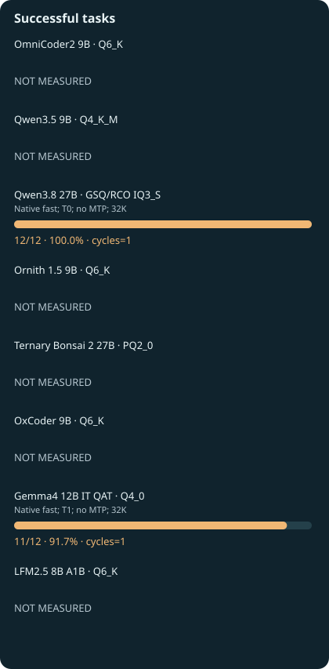{ .benchmark-svg }

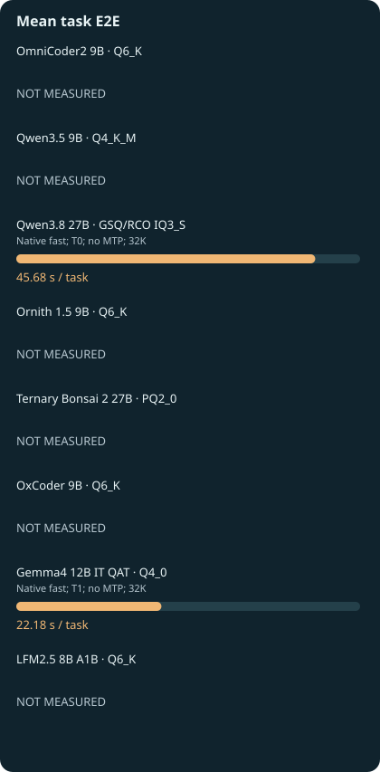{ .benchmark-svg }

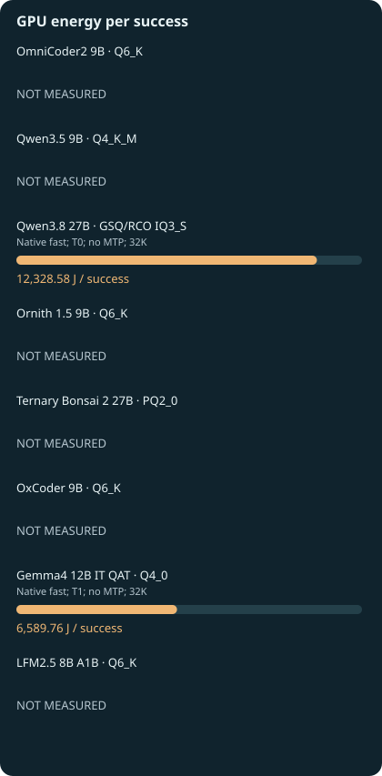{ .benchmark-svg }

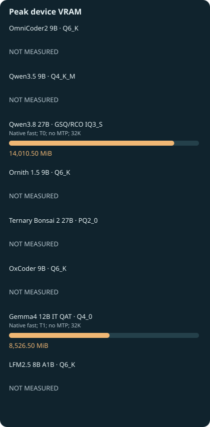{ .benchmark-svg }

| Profile / record date | Success | Successful tasks/s | Total task time / GPU energy | Peak VRAM | Audit |
|---|---|---|---|---|---|
| Gemma4 12B IT QAT Q4_0 — Native fast; T1; no MTP; 32K / 2026-10-22 | 11/12 | 0.04133 | 266.136 s / 72487.35 J | 8526.5 | [R431](experiments/R431.md) |
| Qwen3.8 27B GSQ/RCO IQ3_S — Native fast; T0; no MTP; 32K / 2026-10-22 | 12/12 | 0.02189 | 548.199 s / 147942.94 J | 14010.5 | [R434](experiments/R434.md) |

### Gemma4 12B IT QAT · Q4_0 · R431

Native fast; T1; no MTP; 32K. Separate agent-policy failures remain; this is read-only synthetic inventory retrieval, not agent or assistant qualification.

| Condition | Audited value |
|---|---|
| Separate process-VRAM observation (not device peak) | NOT MEASURED |
| Hardware / power | Tesla V100-SXM2 16 GB HBM2 / 300 W |
| Engine | llama.cpp / CUDA 12.8 / SM70 (exact audited binary below) |
| Date | 2026-10-22 |
| Context, batching, KV, speculation | {"--batch-size": "2048", "--cache-type-k": "f16", "--cache-type-v": "f16", "--ctx-size": "32768", "--reasoning": "off", "--spec-type": "none", "--threads": "6", "--ubatch-size": "512"} |
| Sampling / output cap | {"min_p": 0.0, "presence_penalty": 0.0, "repeat_penalty": 1.0, "seed": 1001, "temperature": 1.0, "top_k": 64, "top_p": 0.95} / 256 |
| Cache / timing scope | Warm model; per-request KV reset; OS file cache uncontrolled; model startup excluded |
| Measurement batches | Single suite or repeated cycles as stated |
| Actual template controls | {"enable_thinking": false} |
| Actual input-token range (if exported) | [29119, 29490] |
| Task count / repeats | 12 unique; one observed answer per task; no repeated-run uncertainty measured |
| Model SHA-256 | 93567e57a8fe10b23569b9d9ec38cd005deedf71e29477c421a4b83f418a538b |
| Engine binary SHA-256 | 08827111e1b856c38d7a3a46ef2d33b36f201d3de76afdf4ac60f061c97fce54 |
| Template SHA-256 | ae53464bf3be25802b3a5b37def7fd89667067d7577049b3b2d74c4d8de4c6d4 |
| Scorer adapter SHA-256 | 719e912326059cd85d3c0915afd648c631fd2841fd4f5ba0baa5831c5cf2e807 |
| EvalPlus provenance SHA-256 | Not applicable / not duplicated |
| Plan SHA-256 | 1712592a47c05ef398bdf9acf30ee365b78fb402f952cc1c7283fac6014c6955 |

Original audit SHA-256 (originals retained privately; public excerpts are not the original files):

- [audit-cd8eb8e97cb00d82a151](audits/audit-cd8eb8e97cb00d82a151.md): `cd8eb8e97cb00d82a151afd35bd6e0d38cbd6e8eac1eadbaecebfa8baf450c80`
- [audit-57702f047eb73912c9f0](audits/audit-57702f047eb73912c9f0.md): `57702f047eb73912c9f0e0cb436535a0a757e711c5df86754bf0f30015097d4b`

### Qwen3.8 27B · GSQ/RCO IQ3_S · R434

Native fast; T0; no MTP; 32K. Separate agent-policy failures remain; this is read-only synthetic inventory retrieval, not agent or assistant qualification.

| Condition | Audited value |
|---|---|
| Separate process-VRAM observation (not device peak) | NOT MEASURED |
| Hardware / power | Tesla V100-SXM2 16 GB HBM2 / 300 W |
| Engine | llama.cpp / CUDA 12.8 / SM70 (exact audited binary below) |
| Date | 2026-10-22 |
| Context, batching, KV, speculation | {"--batch-size": "2048", "--cache-type-k": "f16", "--cache-type-v": "f16", "--ctx-size": "32768", "--reasoning": "off", "--spec-type": "none", "--threads": "6", "--ubatch-size": "512"} |
| Sampling / output cap | {"seed": 1001, "temperature": 0.0} / 256 |
| Cache / timing scope | Warm model; per-request KV reset; OS file cache uncontrolled; model startup excluded |
| Measurement batches | Single suite or repeated cycles as stated |
| Actual template controls | {"enable_thinking": false} |
| Actual input-token range (if exported) | [27415, 27777] |
| Task count / repeats | 12 unique; one observed answer per task; no repeated-run uncertainty measured |
| Model SHA-256 | 58fd826723939933dc86f45b7fe04545cbc2de1c70f6fe2cdd3858c87a98c12f |
| Engine binary SHA-256 | 08827111e1b856c38d7a3a46ef2d33b36f201d3de76afdf4ac60f061c97fce54 |
| Template SHA-256 | c3cf9e34abf4f9e36c2d72165aa9c132d3e2a725b6c2586aaa3a8af9d7a81041 |
| Scorer adapter SHA-256 | 719e912326059cd85d3c0915afd648c631fd2841fd4f5ba0baa5831c5cf2e807 |
| EvalPlus provenance SHA-256 | Not applicable / not duplicated |
| Plan SHA-256 | 619156ecdd8a3ac287376ff4e6d661c8afef89e9244157cc66726bc7c4e5a9ab |

Original audit SHA-256 (originals retained privately; public excerpts are not the original files):

- [audit-d8e1609bb2632a6b88cf](audits/audit-d8e1609bb2632a6b88cf.md): `d8e1609bb2632a6b88cfd55c530a935c3916a66913cdcb4dcc8b8bc2ba485cd9`
- [audit-dfffa11e6009d9343cf0](audits/audit-dfffa11e6009d9343cf0.md): `dfffa11e6009d9343cf0186cdb40df485da2c22f2f043bc52cbbb99bb4a96777`

## Historical synthetic performance — separate protocol

These imported A0 records use historical model/build identities and synthetic native workloads. They are separate from task-success comparisons above. Token/s across tokenizers is a workload measurement, not useful-task superiority. **Bars: stored median; whiskers: median ± measured MAD; labels: MAD and sample size.** There are no invented confidence intervals.

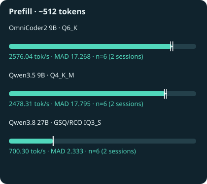{ .benchmark-svg }

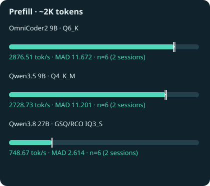{ .benchmark-svg }

{ .benchmark-svg }

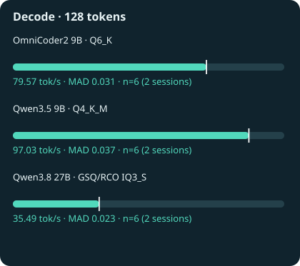{ .benchmark-svg }

### Historical OmniCoder2 9B · Q6_K

| Field | Original reference identity |
|---|---|
| Hardware | Tesla V100-SXM2 16 GB HBM2 |
| Date | NOT RECORDED in imported reference identity; audited in R135 |
| Power limit | NOT RECORDED; do not assume current 300 W |
| Model SHA-256 | b0c1664c86338be24090a45d8b86bd106ba755d004f8746d99ee5ad69258fc3b |
| Engine binary identity | ["71199b6d5fdcde4c27ea83a0bf278fdb2d432ad43fe51411b564c6354e9bb8bd"] |
| Runtime | {"batch_size": 2048, "cache_prompt": false, "ctx": 8192, "decode_ignore_eos": true, "decode_output": 128, "prefill_output": 1, "seed": 1001, "slots": 1, "temperature": 0, "thinking": false, "threads": 6, "tool_max_tokens": 128, "ubatch_size": 512} |
| Reference | e0a5d6c242421e9fd9fedd7f4796c7c0cb5154434fe3908a9053e3b9250da661 |
| Audit SHA-256 | 944476f62657e032732177de16aaaf2fad25362a09532004a73e6ba4a928edc4 |

| Workload | Prompt token count(s) | Generated token count(s) | n / sessions |
|---|---|---|---|
| prefill | [505] | [1] | 6 / 2 |
| prefill2048 | [2048] | [1] | 6 / 2 |
| prefill4096 | [4096] | [1] | 6 / 2 |
| decode | [31] | [128] | 6 / 2 |

[Original audit excerpt](audits/audit-944476f62657e0327321.md). Different tokenizers and historical model/build identities. Not a current task-success ranking; no cross-tokenizer quality or useful-throughput inference.

### Historical Qwen3.5 9B · Q4_K_M

| Field | Original reference identity |
|---|---|
| Hardware | Tesla V100-SXM2 16 GB HBM2 |
| Date | NOT RECORDED in imported reference identity; audited in R135 |
| Power limit | NOT RECORDED; do not assume current 300 W |
| Model SHA-256 | 02d45dc1cf451ba2475ac33b301c2dd8f985abe4c182ce04a1f2f5bf0260278d |
| Engine binary identity | ["71199b6d5fdcde4c27ea83a0bf278fdb2d432ad43fe51411b564c6354e9bb8bd"] |
| Runtime | {"batch_size": 2048, "cache_prompt": false, "ctx": 8192, "decode_ignore_eos": true, "decode_output": 128, "prefill_output": 1, "seed": 1001, "slots": 1, "temperature": 0, "thinking": false, "threads": 6, "tool_max_tokens": 128, "ubatch_size": 512} |
| Reference | 8d659da13e52a886c39537beefbeee5aee65931bd6ddc9a53faa05fe434c891f |
| Audit SHA-256 | 944476f62657e032732177de16aaaf2fad25362a09532004a73e6ba4a928edc4 |

| Workload | Prompt token count(s) | Generated token count(s) | n / sessions |
|---|---|---|---|
| prefill | [505] | [1] | 6 / 2 |
| prefill2048 | [2048] | [1] | 6 / 2 |
| prefill4096 | [4096] | [1] | 6 / 2 |
| decode | [31] | [128] | 6 / 2 |

[Original audit excerpt](audits/audit-944476f62657e0327321.md). Different tokenizers and historical model/build identities. Not a current task-success ranking; no cross-tokenizer quality or useful-throughput inference.

### Historical Qwen3.8 27B · GSQ/RCO IQ3_S

| Field | Original reference identity |
|---|---|
| Hardware | Tesla V100-SXM2 16 GB HBM2 |
| Date | NOT RECORDED in imported reference identity; audited in R135 |
| Power limit | NOT RECORDED; do not assume current 300 W |
| Model SHA-256 | 64b53b64c7aa39f20a7e54bd80582fe595b1d745624ee8a72e92508c0326d810 |
| Engine binary identity | ["71199b6d5fdcde4c27ea83a0bf278fdb2d432ad43fe51411b564c6354e9bb8bd"] |
| Runtime | {"batch_size": 2048, "cache_prompt": false, "ctx": 8192, "decode_ignore_eos": true, "decode_output": 128, "prefill_output": 1, "seed": 1001, "slots": 1, "temperature": 0, "thinking": false, "threads": 6, "tool_max_tokens": 128, "ubatch_size": 512} |
| Reference | 649420efeb0212271674362d3bb3b20bf268a46f5fc40ece74359d7f6ca572fb |
| Audit SHA-256 | 944476f62657e032732177de16aaaf2fad25362a09532004a73e6ba4a928edc4 |

| Workload | Prompt token count(s) | Generated token count(s) | n / sessions |
|---|---|---|---|
| prefill | [505] | [1] | 6 / 2 |
| prefill2048 | [2048] | [1] | 6 / 2 |
| prefill4096 | [4096] | [1] | 6 / 2 |
| decode | [31] | [128] | 6 / 2 |

[Original audit excerpt](audits/audit-944476f62657e0327321.md). Different tokenizers and historical model/build identities. Not a current task-success ranking; no cross-tokenizer quality or useful-throughput inference.

## Scientific metadata correction

The Bonsai agent campaign uses **2048 output tokens per turn**, from executed [R285](experiments/R285.md) and [R286](experiments/R286.md). Earlier chart metadata selected the failed pre-generation [R284](experiments/R284.md) plan and displayed 4096. The success counts, measured costs and immutable original audits are unchanged; coding/native-tool budgets remain separate.

## Missing and partial evidence

A missing bar means no complete audited result under that cohort. In particular, a native echo-control is not a BFCL score, a truncated QA screen is not HumanEval+, and a 2/4 agent early stop is not an 18-task score. See [all model admission stages and negative screens](models.md) and [experiment history](results.md). No existing negative result or qualification limit is removed.
