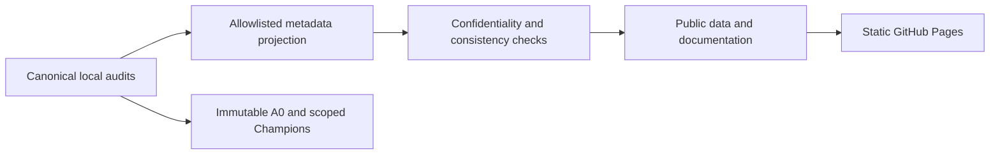

# Overview & hardware

- One Tesla V100-SXM2, 16 GB HBM2; Volta compute capability 7.0 (SM70).
- Research host with an isolated Linux container; serialized device access and a local GPU admission broker.
- CUDA 12.8 llama.cpp/GGUF baseline; driver branch 580.178.04. Engine and weight hashes are recorded per profile.
- FP16 Tensor Cores are available; native BF16/FP8 Tensor Cores, cp.async and TMA are not assumed.
- Context, KV/state precision, graph capture and cache capacity all consume the same limited device memory.
- Temperature is recorded as telemetry. ECC, memory, hardware temperature and restore guards remain mandatory.

Compiler version, CMake-discovered toolkit and loaded runtime are separate identities. R356 found that a compression-mode cache setting was ineffective because a discovered-toolkit version gate omitted the NVCC option; no baseline was changed.
