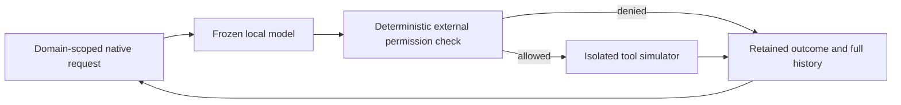

# Lean Jarvis harness

Measured harness trials and reserved validation. Frozen models and external tool permissions remain unchanged; all tools are offline simulators.

**Keep the original minimal single-agent loop.** No tested rewrite qualified. No production deployment.

Original architecture and candidate change point

Rejected candidates inserted a pure request rewrite before the frozen model. The selected reference uses no rewrite or additional agent role.

## Reserved-fixture validation · retained minimal harness

**33 reserved cases ·11 correlated authored families.** Each model retains its frozen8K profile. **Not an official leaderboard** or causal model/harness comparison; no population-equivalence claim.

| Frozen profile | Solved / observed | Case capture | Policy passes | Reported input / output tokens | Completed model calls | Task wall s | GPU J / success bounds | Peak MiB | Preflight / request errors |
|---|---|---|---|---|---|---|---|---|---|
| [R589 · OmniCoder bartowski Q6](experiments/R589.md) | 27/33 | 33/33 complete | 30/33 | 270336 / 21797 | 150 | 388.21 | 3926.90–3931.54 | 7680.5 | 0 / 0 |
| [R590 · Nexus Q6 OFF/T0](experiments/R590.md) | 26/33 | 33/33 complete | 30/33 | 271359 / 16741 | 152 | 325.97 | 3445.81–3449.83 | 7356.5 | 0 / 0 |
| [R591 · Gemma4 QAT Q4_0 frozen8K](experiments/R591.md) | 17/33 | 33/33 complete | 27/33 | 304608 / 13111 | 176 | 422.32 | 6025.80–6031.14 | 8118.5 | 2 / 0 |

Policy failures are rejected proposals, not executed production actions. Failed cases remain in time/energy totals and available token usage. Token counts cover completed-response usage; unknown usage from failed requests is never estimated. Reasoning tokens: **NOT MEASURED** where response instrumentation is absent. NVML bounds are counter-query brackets, not statistical confidence intervals; model loading, warm-up and host CPU energy are excluded. Complete case capture does not mean every case reached inference: preflight failures are shown separately. No population-equivalence or optimized-harness adoption claim.

R589 · frozen configuration and evidence

Context / output: 8192 / 4096 tokens. Captured cases: 33/33. Independent nonroot CPU replay verified retained replies and simulated effects.

Model SHA256: `a73cc3136da753063e667edef95bec3bbf47829e34a2a31bf0f5a29c970f9052`

Captured profile SHA256: `0c085932e8c46a93de995c5feeb1d7c3e65bcdea0f3b9451ab32ff68cb3230b0`

Frozen parent profile SHA256: `e8d6305a50fe0a2522475070c90e25dfbc373be7eba029870941c26a705d2973`

Scorer SHA256: `e18c5e03b37e31ae55092e22f18209970a5b7b318371fd8710a48a764923d43c`

Dataset: `jarvis-lean-holdout-20261027-v1`. Engine binary SHA256: `08827111e1b856c38d7a3a46ef2d33b36f201d3de76afdf4ac60f061c97fce54`; template SHA256: `a4aee8afcf2e0711942cf848899be66016f8d14a889ff9ede07bca099c28f715`. Engine release version: **NOT RECORDED**; hashes are not version numbers. [Frozen sampling, thinking and model settings](final-selection.md).

[Audit and original-capture hashes](experiments/R589.md).

R590 · frozen configuration and evidence

Context / output: 8192 / 4096 tokens. Captured cases: 33/33. Independent nonroot CPU replay verified retained replies and simulated effects.

Model SHA256: `b994abeeffcf3f94162a91e9b3b70c4cce23e8d485d23b9874235af35753ac9c`

Captured profile SHA256: `3144679752edaa4216723252fdb3b572bac6c91c578becabdcdcca60253363f6`

Frozen parent profile SHA256: `c1a06cb4be35d758d43a3a6056b0ab2bb4f5e2d1d197741ded1c43c6f4d54d1d`

Scorer SHA256: `e18c5e03b37e31ae55092e22f18209970a5b7b318371fd8710a48a764923d43c`

Dataset: `jarvis-lean-holdout-20261027-v1`. Engine binary SHA256: `08827111e1b856c38d7a3a46ef2d33b36f201d3de76afdf4ac60f061c97fce54`; template SHA256: `a4aee8afcf2e0711942cf848899be66016f8d14a889ff9ede07bca099c28f715`. Engine release version: **NOT RECORDED**; hashes are not version numbers. [Frozen sampling, thinking and model settings](final-selection.md).

[Audit and original-capture hashes](experiments/R590.md).

R591 · frozen configuration and evidence

Context / output: 8192 / 4096 tokens. Captured cases: 33/33. Independent nonroot CPU replay verified retained replies and simulated effects.

Model SHA256: `93567e57a8fe10b23569b9d9ec38cd005deedf71e29477c421a4b83f418a538b`

Captured profile SHA256: `f1c3f2a04ed4969edab5052c0e775591c9a883fde6f31e38fb8471c70e6058e0`

Frozen parent profile SHA256: `40c9726c13614e7eb6a87a794e65c528bcddf5e32bef6bede930bb1ebc2bfb16`

Scorer SHA256: `e18c5e03b37e31ae55092e22f18209970a5b7b318371fd8710a48a764923d43c`

Context preflight: CONTEXT_BUDGET · 4228 observed prompt tokens + 4096 reserved output > 8192 frozen context (turn 20). No context/output change or answer repair.

Context preflight: CONTEXT_BUDGET · 4217 observed prompt tokens + 4096 reserved output > 8192 frozen context (turn 20). No context/output change or answer repair.

Dataset: `jarvis-lean-holdout-20261027-v1`. Engine binary SHA256: `08827111e1b856c38d7a3a46ef2d33b36f201d3de76afdf4ac60f061c97fce54`; template SHA256: `ae53464bf3be25802b3a5b37def7fd89667067d7577049b3b2d74c4d8de4c6d4`. Engine release version: **NOT RECORDED**; hashes are not version numbers. [Frozen sampling, thinking and model settings](final-selection.md).

[Audit and original-capture hashes](experiments/R591.md).

## Controlled development ablations

These exposed development cases are **not official benchmarks or independent holdout validation**.

## R586 · compact system instructions

**Decision: rejected — preregistered quality/policy gate failed.** Original tools, inference profile and scoring retained; only reviewed system prose changed. One model start, alternating AB/BA across33 paired cases /11 correlated task families.

| Arm | Solved | Policy violations | Input + output tokens | Task wall s | GPU J / success bounds | Peak MiB | Model calls |
|---|---|---|---|---|---|---|---|
| reference | 28/33 | 4 | 301561 | 402.025 | 3892.59–3981.90 | 7680.5 | 154 |
| compact-system-v1 | 25/33 | 6 | 293897 | 347.055 | 3759.13–3858.12 | 7680.5 | 155 |

Paired outcomes: 1 gained, 4 lost; 3 new policy-failure cases. Token reduction 2.54%; task-wall reduction 13.67%. These differences **do not qualify the candidate**.

Measurement limits, hashes and exact source

Reasoning tokens: **NOT MEASURED**. GPU-energy intervals bracket cumulative NVML counter readings, not confidence intervals or calibration error. Failed tasks remain in cost numerators; model loading, warm-up and host CPU energy excluded. No population-equivalence claim.

Transformation CPU seconds (including preservation/audit): reference 0.078495, compact-system-v1 0.078844. Current run TASK phase: 749.095s /1200s. Independent isolated CPU replay reproduced all66 outcomes without model inference.

Captured implementation: transform SHA256 `815681cc326b87a7a6012e1bda85839eb2f3476d466ff24a6e93934ffce563bf`; engine binary SHA256 `08827111e1b856c38d7a3a46ef2d33b36f201d3de76afdf4ac60f061c97fce54`. Transport and simulator identities are retained in the [public experiment data](https://github.com/Maxxxel/v100-volta-ai-optimization-lab/blob/main/data/experiments.json). Source commit for the local transform: **not recorded at execution**; binary hashes are not version numbers. [Frozen model settings](final-selection.md).

[Exact measured request-transform source](assets/harness/system-prose.py) · MIT; file SHA256 matches the captured module. Private fixtures and privileged runner code are not included.

[Experiment and audit hashes](experiments/R586.md). Model SHA256: `a73cc3136da753063e667edef95bec3bbf47829e34a2a31bf0f5a29c970f9052`; captured profile SHA256: `213872c0f5259b8fa4b2966a9dfab0513622e8444994a0a0bcaa9b9ed7f9d681`; scorer SHA256: `0f878d4627a4468f7c8102f73318c31fbff010fa01c52565252d87c731f3cd7b`.

## R587 · compact tool-result JSON

**Decision: rejected — preregistered quality/policy gate failed.** Original tools, inference profile and scoring retained; only insignificant JSON whitespace outside tool-result strings changed. One model start, alternating AB/BA across33 paired cases /11 correlated task families.

| Arm | Solved | Policy violations | Input + output tokens | Task wall s | GPU J / success bounds | Peak MiB | Model calls |
|---|---|---|---|---|---|---|---|
| reference | 28/33 | 4 | 301561 | 402.138 | 3924.56–4014.95 | 7680.5 | 154 |
| compact-tool-json-v1 | 26/33 | 6 | 301598 | 407.192 | 4271.64–4368.67 | 7680.5 | 156 |

Paired outcomes: 0 gained, 2 lost; 1 new policy-failure cases. Token reduction -0.01%; task-wall reduction -1.26%. These differences **do not qualify the candidate**.

Measurement limits, hashes and exact source

Reasoning tokens: **NOT MEASURED**. GPU-energy intervals bracket cumulative NVML counter readings, not confidence intervals or calibration error. Failed tasks remain in cost numerators; model loading, warm-up and host CPU energy excluded. No population-equivalence claim.

Transformation CPU seconds (including preservation/audit): reference 0.063391, compact-tool-json-v1 0.065691. Current run TASK phase: 809.344s /1200s. Independent isolated CPU replay reproduced all66 outcomes without model inference.

CPU postprocessing required a byte-identical readable plan binding and restored permissions on empty sandbox mountpoints. Failed CPU receipts remain preserved; no GPU rerun or scoring-rule change. [Correction evidence](audits/audit-17506b61d17dea89357e.md).

Captured implementation: transform SHA256 `520d70a1f58c373e3a2bce3cca58cb083845f011bad18c7a07de75a8262383cb`; engine binary SHA256 `08827111e1b856c38d7a3a46ef2d33b36f201d3de76afdf4ac60f061c97fce54`. Transport and simulator identities are retained in the [public experiment data](https://github.com/Maxxxel/v100-volta-ai-optimization-lab/blob/main/data/experiments.json). Source commit for the local transform: **not recorded at execution**; binary hashes are not version numbers. [Frozen model settings](final-selection.md).

[Exact measured request-transform source](assets/harness/tool-json.py) · MIT; file SHA256 matches the captured module. Private fixtures and privileged runner code are not included.

[Experiment and audit hashes](experiments/R587.md). Model SHA256: `a73cc3136da753063e667edef95bec3bbf47829e34a2a31bf0f5a29c970f9052`; captured profile SHA256: `b75d892abc3763779d7de5ec8e65ab14a8d5b4e7b44e7729ca1e2dd7b0b10446`; scorer SHA256: `a44040c1553f322dd3e8f00881352871cd7e243e5cbe829d4dc9c83ec6501d4e`.

## R588 · pre-action checklist · B-only screen

**Decision: rejected — preregistered quality/policy gate failed.** Original tools, inference profile and scoring retained; a fixed checklist is added at public pre-action checkpoints. Current run:33 candidate cases; stored original-request control fromR587. **No new A0 run and no fresh paired GPU comparison.**

| Arm | Solved | Policy violations | Input + output tokens | Task wall s | GPU J / success bounds | Peak MiB | Model calls |
|---|---|---|---|---|---|---|---|
| reference · R587 stored | 28/33 | 4 | 301561 | 402.138 | 3924.56–4014.95 | 7680.5 | 154 |
| preaction-checklist-v1 | 29/33 | 3 | 307027 | 440.647 | 4155.18–4159.66 | 7680.5 | 152 |

Case-matched historical-control outcomes: 2 gained, 1 lost; 1 new policy-failure cases. Token reduction -1.81%; task-wall reduction -9.58%. These differences **do not qualify the candidate**.

Measurement limits, hashes and exact source

Reasoning tokens: **NOT MEASURED**. GPU-energy intervals bracket cumulative NVML counter readings, not confidence intervals or calibration error. Failed tasks remain in cost numerators; model loading, warm-up and host CPU energy excluded. No population-equivalence claim.

Transformation CPU seconds (including preservation/audit): reference 0.063391, preaction-checklist-v1 0.053448. Current run TASK phase: 440.656s /1200s. Independent isolated CPU replay reproduced all33 outcomes without model inference.

Captured implementation: transform SHA256 `fc3ef20a6720d2ccbe46699b03b68227f9bb529ab80139b9841a92dd8879bc82`; engine binary SHA256 `08827111e1b856c38d7a3a46ef2d33b36f201d3de76afdf4ac60f061c97fce54`. Transport and simulator identities are retained in the [public experiment data](https://github.com/Maxxxel/v100-volta-ai-optimization-lab/blob/main/data/experiments.json). Source commit for the local transform: **not recorded at execution**; binary hashes are not version numbers. [Frozen model settings](final-selection.md).

[Exact measured request-transform source](assets/harness/preaction-checklist.py) · MIT; file SHA256 matches the captured module. Private fixtures and privileged runner code are not included.

[Experiment and audit hashes](experiments/R588.md). Model SHA256: `a73cc3136da753063e667edef95bec3bbf47829e34a2a31bf0f5a29c970f9052`; captured profile SHA256: `0dfe64ea9a3cbd15a78b355a0074eb93233a03e3182c11b8cd6fd459add754fd`; scorer SHA256: `5d4fa912716b65abfb6644f9468fe4646b500440db751ba3d98237c48781d26c`.

## Technique decisions

**Retain the measured minimal reference.** No tested alternative passed both quality/policy and efficiency gates. Technical reviews and deferred ideas are not GPU qualifications.

Technique coverage, exclusions and source methods

| Approach | Decision / scope |
|---|---|
| Static instruction compression / Caveman style | R586_TESTED_NEGATIVE_NO_ADOPTION — R586 independently replayed66 executions/33 exposed cases: reference28/33 vscompact25/33;policy violations4vs6;tokens-2.54%,task wall-13.67%. Reject observed quality/policy regression; no winner, frozen references unchanged. |
| Lossless tool-result JSON whitespace | R587_TESTED_NEGATIVE_NO_ADOPTION — R587 complete66 executions/33 pairs; independent replay identical. Reference28/33 vscompact26/33; policy violations4vs6; total tokens301561vs301598; task wall402.138vs407.192s. Lexical semantic preservation did not preserve model behavior. Reject; no transfer/promotion justified for this candidate. |
| Minimal sequential loop / mini-SWE-agent patterns | REFERENCE_ALREADY_SEQUENTIAL — Existing simulator uses one native tool action per turn, external permissions and bounded task/turn clocks. Retain its loop instead of importing an extra environment/orchestrator; upstream unbounded defaults/provider monetary budgets do not replace local guards. |
| Tool-schema descriptions | DEFERRED_SEMANTIC_REWRITE_REQUIRES_NEW_CONTRACT_AND_HYPOTHESIS — Four workflow overrides carry object scope, read-before-write, source-hash, preview and authorization semantics. Existing loop already exposes only the task domain. No validated redundant schema field identified; meaning-preserving rewrites need their own native-template token and policy contracts. R586 generic prose compression already regressed; this does not prove every schema rewrite ineffective. |
| Selective retrieval / tool exposure | REFERENCE_DOMAIN_SCOPING_RETAINED_NO_NEW_RETRIEVAL_WINNER — Reference fake_function_schemas offers the task domain only; tasks access files/state through bounded read/search calls. This is already measured reference behavior, not a newly attributed speedup. Retrospectives found no eligible duplicate reads without a state/error barrier. More aggressive evidence removal/retrieval needs a new contract and workload-specific hypothesis. |
| Adaptive history compaction | EXACT_DUPLICATE_REUSE_DEFERRED_NO_ELIGIBLE_PAYLOAD_SEMANTIC_COMPACTION_UNQUALIFIED — CPU trace crosscheck: Omni154/Nexus153/Gemma177 requests contain319/302/407 eligible successful read observations, but zero identical function+argument+result duplicates without intervening mutation/error/denial barriers. Duplicate outputs ignoring barriers:9/0/243. Thus the predicate is nonempty and exact-read reuse offers no observed payload to remove in these traces. No GPU or token/energy gain claim; semantic compaction and other workloads remain unqualified. |
| Conditional reviewer / verification | R588_SCREEN_COMPLETE_NOT_QUALIFIED — B-only33 vsstored R587 control:29vs28 solved;3vs4 violations overall, but2 gained/1 lost and1 new policy-failure case. Input+output307027vs301561; task wall440.647vs402.138s; candidateGPU J/success4155.18–4159.66 vscontrol3924.56–4014.95. No fresh paired run, no adoption; preregistered case-level gate failed and no efficiency gain. |
| Adaptive reasoning | FROZEN_BASE_CONTROLS_RETAINED_CONDITIONAL_CHECKLIST_NEGATIVE — Final3 Thinking/sampling/output settings remain frozen. R588 tested an isolated conditional pre-action verification reminder without extra roles/calls; it added cost and a new policy-failure case. No unmeasured dynamic reasoning-budget benefit is claimed. |
| Redundant-call / retry control | REFERENCE_RETROSPECTIVE_NO_ADJACENT_IDENTICAL_FAILURE_LOOP — R586 retained reference33 cases: no adjacent identical tool call + identical failed output repeated in final request histories. Assistant tool-call commentary is already empty. No measured savings or universal no-retry claim; preserve recovery and post-write verification. |
| Compatible combinations | NOT_APPLICABLE_NO_QUALIFIED_COMPONENTS_IN_THIS_ROUND — R586/R587 failed observed quality/policy gates; R588 failed case-level policy gate and efficiency. Combining these rejected components is not scientifically justified. Existing pre-goal inference profiles remain unchanged. |
| Engine prefix/KV caching, MTP, kernels and weight precision | SUBSEQUENT_INFERENCE_GOAL_ONLY — Do not change cache_prompt=false, engine, template, MTP or quantization during harness isolation. Existing earlier inference results remain valid in their qualified scopes. |

CPU checks reused160 prior one-shot requests: no tool-result history for JSON compression and no matching effect-tool pre-action trigger. The existing compact-system module rejects their distinct preambles; this is not a general rejection of new prompt hypotheses. Exact duplicate-read reuse found no eligible payload after state/error barriers across484 reference requests. These are applicability findings, not token or speedup measurements.

The pinned Caveman default JSON-elision route found no eligible long array in the reviewed Omni reference histories (all136 arrays have1–4 elements). TOON encoding remains deferred: ordered-field eligibility, native-token benefit and model interpretation are not locally qualified. No full proxy installed.

[what-does-a-harness-buy · pinned source](https://github.com/YangzeLiu/what-does-a-harness-buy/tree/ae47f036733b86de26c036b0008cf41851211c8d) · `ae47f036733b86de26c036b0008cf41851211c8d`. TARGETED_SOURCE_METHOD_REVIEW_NOT_EXECUTED_OR_FULLY_REPRODUCED. Original analysis source mechanisms verified at pinned Git blobs; scripts not executed, full publisher replication not claimed. Provider-priced costs are not V100 GPU-J.

[caveman · pinned source](https://github.com/JuliusBrussee/caveman/tree/9b68f7ed12b05e7efaff18e65c5a3fc2849fd0a4) · `9b68f7ed12b05e7efaff18e65c5a3fc2849fd0a4`. TARGETED_SOURCE_REVIEW_NO_INSTALL_OR_EXECUTION. Do not install a full gateway for zero-op default elision. TOON remains P2:66 potential uniform flat arrays in repeated R536 histories, but ordered-field eligibility, native-token gain, roundtrip/security contracts and model interpretation are unqualified. Long table-heavy workloads or a bounded approved codec could justify a later isolated development experiment; do not claim all compaction impossible.

Frozen next-goal reference: `jarvis-minimal-harness-reference-20261027-v1` · SHA256 `a05002ad3e90660ad69047f81310276c1ffa0c10e59e72c635e2204802ada57b`. Inference tuning must keep this harness fixed, use development data for parameter selection, and independently verify any finalist. Reserved fixtures are now exposed; do not retune on them or continue to call future runs unseen.

Original source-plan SHA256: `c8c96ae988af2529dd75110cf1d15484f575e642a725c23d4d1217a101771eb9`. Complete reviewed source identities and scoped decisions: [public snapshot](https://github.com/Maxxxel/v100-volta-ai-optimization-lab/blob/main/data/snapshot.json).

## Next gate

Retain the original minimal reference: none of the tested alternatives passed the quality/policy and efficiency gates. No rejected components are combined. Reserved validation and model-specific technical limits are reported separately; no optimized harness has been adopted.

[Issue17](https://github.com/Maxxxel/v100-volta-ai-optimization-lab/issues/17) · [Issue18](https://github.com/Maxxxel/v100-volta-ai-optimization-lab/issues/18)
