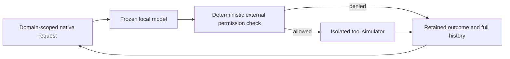

# Lean Jarvis harness

Measured harness trials and reserved validation. Frozen models and external tool permissions remain unchanged; all tools are offline simulators.

**Keep the original minimal single-agent loop.** No tested rewrite qualified. No production deployment.

Original architecture and candidate change point

Rejected candidates inserted a pure request rewrite before the frozen model. The selected reference uses no rewrite or additional agent role.

## Reserved-fixture validation · retained minimal harness

**33 reserved cases ·11 correlated authored families.** Each model retains its frozen8K profile. **Not an official leaderboard** or causal model/harness comparison; no population-equivalence claim.

| Frozen profile | Solved / observed | Case capture | Policy passes | Reported input / output tokens | Completed model calls | Task wall s | GPU J / success bounds | Peak MiB | Preflight / request errors |
|---|---|---|---|---|---|---|---|---|---|
| [R589 · OmniCoder bartowski Q6](experiments/R589.md) | 27/33 | 33/33 complete | 30/33 | 270336 / 21797 | 150 | 388.21 | 3926.90–3931.54 | 7680.5 | 0 / 0 |
| [R590 · Nexus Q6 OFF/T0](experiments/R590.md) | 26/33 | 33/33 complete | 30/33 | 271359 / 16741 | 152 | 325.97 | 3445.81–3449.83 | 7356.5 | 0 / 0 |
| [R591 · Gemma4 QAT Q4_0 frozen8K](experiments/R591.md) | 17/33 | 33/33 complete | 27/33 | 304608 / 13111 | 176 | 422.32 | 6025.80–6031.14 | 8118.5 | 2 / 0 |

Policy failures are rejected proposals, not executed production actions. Failed cases remain in time/energy totals and available token usage. Token counts cover completed-response usage; unknown usage from failed requests is never estimated. Reasoning tokens: **NOT MEASURED** where response instrumentation is absent. NVML bounds are counter-query brackets, not statistical confidence intervals; model loading, warm-up and host CPU energy are excluded. Complete case capture does not mean every case reached inference: preflight failures are shown separately. No population-equivalence or optimized-harness adoption claim.

R589 · frozen configuration and evidence

Context / output: 8192 / 4096 tokens. Captured cases: 33/33. Independent nonroot CPU replay verified retained replies and simulated effects.

Model SHA256: `a73cc3136da753063e667edef95bec3bbf47829e34a2a31bf0f5a29c970f9052`

Captured profile SHA256: `0c085932e8c46a93de995c5feeb1d7c3e65bcdea0f3b9451ab32ff68cb3230b0`

Frozen parent profile SHA256: `e8d6305a50fe0a2522475070c90e25dfbc373be7eba029870941c26a705d2973`

Scorer SHA256: `e18c5e03b37e31ae55092e22f18209970a5b7b318371fd8710a48a764923d43c`

Dataset: `jarvis-lean-holdout-20261027-v1`. Engine binary SHA256: `08827111e1b856c38d7a3a46ef2d33b36f201d3de76afdf4ac60f061c97fce54`; template SHA256: `a4aee8afcf2e0711942cf848899be66016f8d14a889ff9ede07bca099c28f715`. Engine release version: **NOT RECORDED**; hashes are not version numbers. [Frozen sampling, thinking and model settings](final-selection.md).

[Audit and original-capture hashes](experiments/R589.md).

R590 · frozen configuration and evidence

Context / output: 8192 / 4096 tokens. Captured cases: 33/33. Independent nonroot CPU replay verified retained replies and simulated effects.

Model SHA256: `b994abeeffcf3f94162a91e9b3b70c4cce23e8d485d23b9874235af35753ac9c`

Captured profile SHA256: `3144679752edaa4216723252fdb3b572bac6c91c578becabdcdcca60253363f6`

Frozen parent profile SHA256: `c1a06cb4be35d758d43a3a6056b0ab2bb4f5e2d1d197741ded1c43c6f4d54d1d`

Scorer SHA256: `e18c5e03b37e31ae55092e22f18209970a5b7b318371fd8710a48a764923d43c`

Dataset: `jarvis-lean-holdout-20261027-v1`. Engine binary SHA256: `08827111e1b856c38d7a3a46ef2d33b36f201d3de76afdf4ac60f061c97fce54`; template SHA256: `a4aee8afcf2e0711942cf848899be66016f8d14a889ff9ede07bca099c28f715`. Engine release version: **NOT RECORDED**; hashes are not version numbers. [Frozen sampling, thinking and model settings](final-selection.md).

[Audit and original-capture hashes](experiments/R590.md).

R591 · frozen configuration and evidence

Context / output: 8192 / 4096 tokens. Captured cases: 33/33. Independent nonroot CPU replay verified retained replies and simulated effects.

Model SHA256: `93567e57a8fe10b23569b9d9ec38cd005deedf71e29477c421a4b83f418a538b`

Captured profile SHA256: `f1c3f2a04ed4969edab5052c0e775591c9a883fde6f31e38fb8471c70e6058e0`

Frozen parent profile SHA256: `40c9726c13614e7eb6a87a794e65c528bcddf5e32bef6bede930bb1ebc2bfb16`

Scorer SHA256: `e18c5e03b37e31ae55092e22f18209970a5b7b318371fd8710a48a764923d43c`

Context preflight: CONTEXT_BUDGET · 4228 observed prompt tokens + 4096 reserved output > 8192 frozen context (turn 20). No context/output change or answer repair.

Context preflight: CONTEXT_BUDGET · 4217 observed prompt tokens + 4096 reserved output > 8192 frozen context (turn 20). No context/output change or answer repair.

Dataset: `jarvis-lean-holdout-20261027-v1`. Engine binary SHA256: `08827111e1b856c38d7a3a46ef2d33b36f201d3de76afdf4ac60f061c97fce54`; template SHA256: `ae53464bf3be25802b3a5b37def7fd89667067d7577049b3b2d74c4d8de4c6d4`. Engine release version: **NOT RECORDED**; hashes are not version numbers. [Frozen sampling, thinking and model settings](final-selection.md).

[Audit and original-capture hashes](experiments/R591.md).

## Controlled development ablations

These exposed development cases are **not official benchmarks or independent holdout validation**.

## R586 · compact system instructions

**Decision: rejected — preregistered quality/policy gate failed.** Original tools, inference profile and scoring retained; only reviewed system prose changed. One model start, alternating AB/BA across33 paired cases /11 correlated task families.

| Arm | Solved | Policy violations | Input + output tokens | Task wall s | GPU J / success bounds | Peak MiB | Model calls |
|---|---|---|---|---|---|---|---|
| reference | 28/33 | 4 | 301561 | 402.025 | 3892.59–3981.90 | 7680.5 | 154 |
| compact-system-v1 | 25/33 | 6 | 293897 | 347.055 | 3759.13–3858.12 | 7680.5 | 155 |

Paired outcomes: 1 gained, 4 lost; 3 new policy-failure cases. Token reduction 2.54%; task-wall reduction 13.67%. These differences **do not qualify the candidate**.

Measurement limits, hashes and exact source

Reasoning tokens: **NOT MEASURED**. GPU-energy intervals bracket cumulative NVML counter readings, not confidence intervals or calibration error. Failed tasks remain in cost numerators; model loading, warm-up and host CPU energy excluded. No population-equivalence claim.

Transformation CPU seconds (including preservation/audit): reference 0.078495, compact-system-v1 0.078844. Current run TASK phase: 749.095s /1200s. Independent isolated CPU replay reproduced all66 outcomes without model inference.

Captured implementation: transform SHA256 `815681cc326b87a7a6012e1bda85839eb2f3476d466ff24a6e93934ffce563bf`; engine binary SHA256 `08827111e1b856c38d7a3a46ef2d33b36f201d3de76afdf4ac60f061c97fce54`. Transport and simulator identities are retained in the [public experiment data](https://github.com/Maxxxel/v100-volta-ai-optimization-lab/blob/main/data/experiments.json). Source commit for the local transform: **not recorded at execution**; binary hashes are not version numbers. [Frozen model settings](final-selection.md).

[Exact measured request-transform source](assets/harness/system-prose.py) · MIT; file SHA256 matches the captured module. Private fixtures and privileged runner code are not included.

[Experiment and audit hashes](experiments/R586.md). Model SHA256: `a73cc3136da753063e667edef95bec3bbf47829e34a2a31bf0f5a29c970f9052`; captured profile SHA256: `213872c0f5259b8fa4b2966a9dfab0513622e8444994a0a0bcaa9b9ed7f9d681`; scorer SHA256: `0f878d4627a4468f7c8102f73318c31fbff010fa01c52565252d87c731f3cd7b`.

## R587 · compact tool-result JSON

**Decision: rejected — preregistered quality/policy gate failed.** Original tools, inference profile and scoring retained; only insignificant JSON whitespace outside tool-result strings changed. One model start, alternating AB/BA across33 paired cases /11 correlated task families.

| Arm | Solved | Policy violations | Input + output tokens | Task wall s | GPU J / success bounds | Peak MiB | Model calls |
|---|---|---|---|---|---|---|---|
| reference | 28/33 | 4 | 301561 | 402.138 | 3924.56–4014.95 | 7680.5 | 154 |
| compact-tool-json-v1 | 26/33 | 6 | 301598 | 407.192 | 4271.64–4368.67 | 7680.5 | 156 |

Paired outcomes: 0 gained, 2 lost; 1 new policy-failure cases. Token reduction -0.01%; task-wall reduction -1.26%. These differences **do not qualify the candidate**.

Measurement limits, hashes and exact source

Reasoning tokens: **NOT MEASURED**. GPU-energy intervals bracket cumulative NVML counter readings, not confidence intervals or calibration error. Failed tasks remain in cost numerators; model loading, warm-up and host CPU energy excluded. No population-equivalence claim.

Transformation CPU seconds (including preservation/audit): reference 0.063391, compact-tool-json-v1 0.065691. Current run TASK phase: 809.344s /1200s. Independent isolated CPU replay reproduced all66 outcomes without model inference.

CPU postprocessing required a byte-identical readable plan binding and restored permissions on empty sandbox mountpoints. Failed CPU receipts remain preserved; no GPU rerun or scoring-rule change. [Correction evidence](audits/audit-17506b61d17dea89357e.md).

Captured implementation: transform SHA256 `520d70a1f58c373e3a2bce3cca58cb083845f011bad18c7a07de75a8262383cb`; engine binary SHA256 `08827111e1b856c38d7a3a46ef2d33b36f201d3de76afdf4ac60f061c97fce54`. Transport and simulator identities are retained in the [public experiment data](https://github.com/Maxxxel/v100-volta-ai-optimization-lab/blob/main/data/experiments.json). Source commit for the local transform: **not recorded at execution**; binary hashes are not version numbers. [Frozen model settings](final-selection.md).

[Exact measured request-transform source](assets/harness/tool-json.py) · MIT; file SHA256 matches the captured module. Private fixtures and privileged runner code are not included.

[Experiment and audit hashes](experiments/R587.md). Model SHA256: `a73cc3136da753063e667edef95bec3bbf47829e34a2a31bf0f5a29c970f9052`; captured profile SHA256: `b75d892abc3763779d7de5ec8e65ab14a8d5b4e7b44e7729ca1e2dd7b0b10446`; scorer SHA256: `a44040c1553f322dd3e8f00881352871cd7e243e5cbe829d4dc9c83ec6501d4e`.

## R588 · pre-action checklist · B-only screen

**Decision: rejected — preregistered quality/policy gate failed.** Original tools, inference profile and scoring retained; a fixed checklist is added at public pre-action checkpoints. Current run:33 candidate cases; stored original-request control fromR587. **No new A0 run and no fresh paired GPU comparison.**

| Arm | Solved | Policy violations | Input + output tokens | Task wall s | GPU J / success bounds | Peak MiB | Model calls |
|---|---|---|---|---|---|---|---|
| reference · R587 stored | 28/33 | 4 | 301561 | 402.138 | 3924.56–4014.95 | 7680.5 | 154 |
| preaction-checklist-v1 | 29/33 | 3 | 307027 | 440.647 | 4155.18–4159.66 | 7680.5 | 152 |

Case-matched historical-control outcomes: 2 gained, 1 lost; 1 new policy-failure cases. Token reduction -1.81%; task-wall reduction -9.58%. These differences **do not qualify the candidate**.

Measurement limits, hashes and exact source

Reasoning tokens: **NOT MEASURED**. GPU-energy intervals bracket cumulative NVML counter readings, not confidence intervals or calibration error. Failed tasks remain in cost numerators; model loading, warm-up and host CPU energy excluded. No population-equivalence claim.

Transformation CPU seconds (including preservation/audit): reference 0.063391, preaction-checklist-v1 0.053448. Current run TASK phase: 440.656s /1200s. Independent isolated CPU replay reproduced all33 outcomes without model inference.

Captured implementation: transform SHA256 `fc3ef20a6720d2ccbe46699b03b68227f9bb529ab80139b9841a92dd8879bc82`; engine binary SHA256 `08827111e1b856c38d7a3a46ef2d33b36f201d3de76afdf4ac60f061c97fce54`. Transport and simulator identities are retained in the [public experiment data](https://github.com/Maxxxel/v100-volta-ai-optimization-lab/blob/main/data/experiments.json). Source commit for the local transform: **not recorded at execution**; binary hashes are not version numbers. [Frozen model settings](final-selection.md).

[Exact measured request-transform source](assets/harness/preaction-checklist.py) · MIT; file SHA256 matches the captured module. Private fixtures and privileged runner code are not included.

[Experiment and audit hashes](experiments/R588.md). Model SHA256: `a73cc3136da753063e667edef95bec3bbf47829e34a2a31bf0f5a29c970f9052`; captured profile SHA256: `0dfe64ea9a3cbd15a78b355a0074eb93233a03e3182c11b8cd6fd459add754fd`; scorer SHA256: `5d4fa912716b65abfb6644f9468fe4646b500440db751ba3d98237c48781d26c`.

## R598 · original Caveman TOON · B-only screen

**Decision: rejected — preregistered quality/policy gate failed.** Original tools, inference profile and scoring retained; only tool-result representation changes through the original upstream stateless TOON codec, after exact structured roundtrip validation; unsupported outputs remain original. Current run:33 candidate cases; stored original-request control fromR587. **No new A0 run and no fresh paired GPU comparison.**

| Arm | Solved | Policy violations | Input + output tokens | Task wall s | GPU J / success bounds | Peak MiB | Model calls |
|---|---|---|---|---|---|---|---|
| reference · R587 stored | 28/33 | 4 | 301561 | 402.138 | 3924.56–4014.95 | 7680.5 | 154 |
| upstream-tool-toon-v1 | 26/33 | 4 | 290661 | 391.541 | 4083.03–4089.49 | 7688.5 | 151 |

Case-matched historical-control outcomes: 1 gained, 3 lost; 1 new policy-failure cases. Token reduction 3.61%; task-wall reduction 2.64%. These differences **do not qualify the candidate**.

Measurement limits, hashes and exact source

Reasoning tokens: **NOT MEASURED**. GPU-energy intervals bracket cumulative NVML counter readings, not confidence intervals or calibration error. Failed tasks remain in cost numerators; model loading, warm-up and host CPU energy excluded. No population-equivalence claim.

Transformation CPU seconds (including preservation/audit): reference 0.063391, upstream-tool-toon-v1 0.317740. Current run TASK phase: 391.550s /1200s. Independent isolated CPU replay reproduced all33 outcomes without model inference.

Captured implementation: transform SHA256 `c9a39349e84e94996ef12d8ab2c6b7833b11658fe9f37c99bda9d105df9e32a0`; engine binary SHA256 `08827111e1b856c38d7a3a46ef2d33b36f201d3de76afdf4ac60f061c97fce54`. Transport and simulator identities are retained in the [public experiment data](https://github.com/Maxxxel/v100-volta-ai-optimization-lab/blob/main/data/experiments.json). Source commit for the local transform: **not recorded at execution**; binary hashes are not version numbers. [Frozen model settings](final-selection.md).

Original upstream commit `9b68f7ed12b05e7efaff18e65c5a3fc2849fd0a4`; codec SHA256 `80189ce6b009ea9fba762cdef88d568f20a8640fde4302f50a2cfcb36ab1d754`. Codec subprocess overhead is included in task wall time. Parent-only transformation CPU excludes child codec CPU; host CPU energy is **NOT MEASURED**. No byte-to-token estimates.

Measured codec subprocess wall 2.305084s; parent CPU 0.171911s; child CPU 2.318493s across 336 tool-result visits. These component timings are already inside task wall; do not add them again.

Warm-up separately: 2 calls, 536 input / 129 output tokens, 1.966683s response wall. Warm-up is outside TASK; no allocation to the reused historical reference.

[Exact measured request-transform source](assets/harness/original-toon-adapter.py) · MIT; file SHA256 matches the captured module. Private fixtures and privileged runner code are not included.

[Experiment and audit hashes](experiments/R598.md). Model SHA256: `a73cc3136da753063e667edef95bec3bbf47829e34a2a31bf0f5a29c970f9052`; captured profile SHA256: `20b28ea71a8fb690a6950d51795a288d5804f9d0c1f9f0dc4ae590fa51dabc62`; scorer SHA256: `a1e8352762347f269123c203022990a860b735414ee0b3949ae41a2d126515e1`.

## R600 · original Caveman Node shrink · B-only screen

**Decision: rejected — preregistered quality/policy gate failed.** Original tools, inference profile and scoring retained; only tool descriptions in the exact ten reviewed catalogs change through the original Node compressor; messages, tool arguments, typed schemas and authoritative results remain unchanged, and unknown catalogs pass through unchanged. Current run:33 candidate cases; stored original-request control fromR587. **No new A0 run and no fresh paired GPU comparison.**

| Arm | Solved | Policy violations | Input + output tokens | Task wall s | GPU J / success bounds | Peak MiB | Model calls |
|---|---|---|---|---|---|---|---|
| reference · R587 stored | 28/33 | 4 | 301561 | 402.138 | 3924.56–4014.95 | 7680.5 | 154 |
| upstream-node-shrink-v1 | 26/33 | 6 | 302821 | 418.846 | 4369.21–4374.57 | 7680.5 | 155 |

[Exact request wrapper](assets/harness/original-node-shrink-request.cjs).

Original Node codec: 155 catalog transformations; 4.484s codec invocation wall, 0.079s parent CPU, 4.526s child CPU. Already included in task wall; do not add twice. Host CPU energy: NOT MEASURED. Source `JuliusBrussee/caveman@9b68f7ed12b05e7efaff18e65c5a3fc2849fd0a4`, Apache-2.0; Node24.22.0. This is distinct from the rejected Go toolschema default.

Case-matched historical-control outcomes: 0 gained, 2 lost; 2 new policy-failure cases. Token reduction -0.42%; task-wall reduction -4.15%. These differences **do not qualify the candidate**.

Measurement limits, hashes and exact source

Reasoning tokens: **NOT MEASURED**. GPU-energy intervals bracket cumulative NVML counter readings, not confidence intervals or calibration error. Failed tasks remain in cost numerators; model loading, warm-up and host CPU energy excluded. No population-equivalence claim.

Transformation CPU seconds (including preservation/audit): reference 0.063391, upstream-node-shrink-v1 0.181020. Current run TASK phase: 418.855s /1200s. Independent isolated CPU replay reproduced all33 outcomes without model inference.

Captured implementation: transform SHA256 `23239654f8ebf8ef5493f2ac267c5085597788e374f7df7d8243659ab571bab5`; engine binary SHA256 `08827111e1b856c38d7a3a46ef2d33b36f201d3de76afdf4ac60f061c97fce54`. Transport and simulator identities are retained in the [public experiment data](https://github.com/Maxxxel/v100-volta-ai-optimization-lab/blob/main/data/experiments.json). Source commit for the local transform: **not recorded at execution**; binary hashes are not version numbers. [Frozen model settings](final-selection.md).

[Exact measured request-transform source](assets/harness/original-node-shrink-adapter.py) · MIT; file SHA256 matches the captured module. Private fixtures and privileged runner code are not included.

[Experiment and audit hashes](experiments/R600.md). Model SHA256: `a73cc3136da753063e667edef95bec3bbf47829e34a2a31bf0f5a29c970f9052`; captured profile SHA256: `b39505ffe08c8c742f9521aeadb87270dc33482324b27a0194e3d28ba97ca09e`; scorer SHA256: `40f34ec50d64fd46cccac52f8ef66d4a1aed0d253dde3829933b4a1e4553ccb6`.

## R601 · original mini-SWE DefaultAgent · B-only screen

**Screen: no practical gain; no promotion or follow-up confirmation justified for this exact profile.** Original tools, inference profile and scoring retained; the pinned upstream DefaultAgent controls the frozen native model/backend and permission simulator; no stock shell/provider path. Current run:33 candidate cases; stored original-request control fromR587. **No new A0 run and no fresh paired GPU comparison.**

| Arm | Solved | Policy violations | Input + output tokens | Task wall s | GPU J / success bounds | Peak MiB | Model calls |
|---|---|---|---|---|---|---|---|
| reference · R587 stored | 28/33 | 4 | 301561 | 402.138 | 3924.56–4014.95 | 7680.5 | 154 |
| original-mini-swe-native-v1 | 28/33 | 4 | 301561 | 402.838 | 3918.08–3924.34 | 7680.5 | 154 |

Stored-reference screen: R587 original arm and R601 candidate both solved28/33, passed29/33 policy gates, used279033 input +22528 output tokens and154 calls. R601 took402.838s vs402.138s; the candidate was0.174% slower. Its conservative GPU-energy delta is only0.0054% (counter bounds separated by0.213 J/success), against a historical, non-paired reference; **no practical gain**. These exposed cases are not fresh paired evidence or a holdout. Upstream mini-SWE-agent `2.4.6` · commit `04d809ceab9df28f9adaed044884180159172930`; 2.800s measured parent-controller CPU, added to the single candidate capture. [R601 audit](experiments/R601.md).

Case-matched historical-control outcomes: 0 gained, 0 lost; 0 new policy-failure cases. Token reduction 0.00%; task-wall reduction -0.17%. These differences **do not qualify the candidate**.

Measurement limits, hashes and exact source

Reasoning tokens: **NOT MEASURED**. GPU-energy intervals bracket cumulative NVML counter readings, not confidence intervals or calibration error. Failed tasks remain in cost numerators; model loading, warm-up and host CPU energy excluded. No population-equivalence claim.

Transformation CPU seconds (including preservation/audit): reference 0.063391, original-mini-swe-native-v1 0.145706. Current run TASK phase: 402.848s /1200s. Independent isolated CPU replay reproduced all33 outcomes without model inference.

Captured implementation: transform SHA256 `3a3a38fc0fbe6546b89a3e72948a03d6fd49b37164f0a634f7e911e040d53950`; engine binary SHA256 `08827111e1b856c38d7a3a46ef2d33b36f201d3de76afdf4ac60f061c97fce54`. Transport and simulator identities are retained in the [public experiment data](https://github.com/Maxxxel/v100-volta-ai-optimization-lab/blob/main/data/experiments.json). Source commit for the local transform: **not recorded at execution**; binary hashes are not version numbers. [Frozen model settings](final-selection.md).

[Experiment and audit hashes](experiments/R601.md). Model SHA256: `a73cc3136da753063e667edef95bec3bbf47829e34a2a31bf0f5a29c970f9052`; captured profile SHA256: `5a428e6d63f898b5dd8b86f07fc73a408c53f78d4dd1edd8ce456a227115263a`; scorer SHA256: `5b13a22337107a5a7821dedf05ab7ff546ecae77c62ebb346b9e0c6e2a8c555d`.

## Frozen16 +16 development screen · R592

**Promising screen; not a qualified gain.** local preamble rewrite. Stored R515 control: Coding 14/16, Tools 14/16; candidate: Coding 14/16, Tools 14/16.

| Profile | Input tokens | Completion tokens | TASK seconds | GPU J/success interval | Peak MiB |
|---|---|---|---|---|---|
| R515 original | 13007 | 4348 | 62.665 | 581.900–584.677 | 7680.500 |
| R592 candidate | 12751 | 3991 | 58.430 | 542.090–545.648 | 7680.500 |

Changes versus stored control: total tokens -3.532%; TASK latency including captured rewrite -6.749%; conservative GPU J/success -6.230%. A fresh controlled comparison and unseen confirmation are required before any promotion. [Audit](experiments/R592.md).

Scope and source hashes

Exposed frozen16coding+16mocktool development; stored R515 control, one candidate B run. No fresh A/B or qualified improvement. Input+completion totals; reasoning not separately reported. Failed tasks included in energy numerator; load/warmup and CPU energy excluded. Reasoning: NOT MEASURED. Captured transform CPU 0.005s; wall 0.005s. This is a local prose rewrite, not upstream Caveman. Comparison SHA256 `4d086a5aa654adef1de48bb6d32b5daec56a7696b59ce6200b4e4121e353df36`.

## Frozen16 +16 development screen · R593

**Rejected exact profile; not a qualified gain.** actual pinned upstream style skill. Stored R515 control: Coding 14/16, Tools 14/16; candidate: Coding 2/16, Tools 6/16.

| Profile | Input tokens | Completion tokens | TASK seconds | GPU J/success interval | Peak MiB |
|---|---|---|---|---|---|
| R515 original | 13007 | 4348 | 62.665 | 581.900–584.677 | 7680.500 |
| R593 candidate | 49071 | 2392 | 50.997 | 1648.474–1660.266 | 7680.500 |

Changes versus stored control: total tokens +196.531%; TASK latency including captured rewrite -18.612%; conservative GPU J/success +185.318%. A fresh controlled comparison and unseen confirmation are required before any promotion. [Audit](experiments/R593.md).

Scope and source hashes

Exposed frozen16coding+16mocktool development; stored R515 control, one candidate B run. No fresh A/B or qualified improvement. Input+completion totals; reasoning not separately reported. Failed tasks included in energy numerator; load/warmup and CPU energy excluded. Reasoning: NOT MEASURED. Captured transform CPU 0.005s; wall 0.005s. This uses the original pinned Caveman instruction skill, not its model-assisted compressor or proxy. Rejection applies only to this exact tested profile. Comparison SHA256 `1e4dd8f79d2b6c654759ec2a6ea2b947676f5c075b218f229f56a1ab1c127d27`.

## Fresh A/B confirmation · R594

**Historical development candidate; subsequent R599 fresh validation rejected adoption.** 32 unique exposed tasks, 64 requests, 1 resident model. A: Coding 14/16, Tools 14/16; B: Coding 14/16, Tools 14/16; no changed task judgments.

| Arm | Reported tokens | Request E2E seconds | GPU J/success interval |
|---|---|---|---|
| A · original | 17355 | 62.727 | 561.028–636.104 |
| B · compact | 16742 | 58.113 | 508.632–581.846 |

Compact instruction variant: -7.355% summed request latency, -3.532% input+completion tokens. **Energy saving NOT CONFIRMED**: counter timing brackets overlap. Shared TASK 120.874s /1200s; per-arm TASK time is not assigned. [R594 audit](experiments/R594.md).

Fresh-control profile, timing scope and hashes

Exposed16coding+16mock-tool development; one fresh balanced A/B, same frozen Omni model/engine/native template. Per-arm latency sums request E2E intervals; joint TASK/startup/compilation are not divided. Counter brackets are not confidence intervals. Not a general Agent33 gain or official score; unseen confirmation still required. Reasoning tokens: NOT MEASURED. Native context 8192; requested output 4096; temperature 0; seed 1001. Date 2026-10-27T17:28:42.179420+00:00. Model SHA256 `a73cc3136da753063e667edef95bec3bbf47829e34a2a31bf0f5a29c970f9052`; profile `55ed8246abe30e84ff5ba0a04c64826d28cdc3fd1b4ade5ff1d2acaaad7e2dd8`; comparison `59847ba57c16da2ff7e9ef5880f401a14a5ff5effbd26e4fe24ebcf03ecbb98f`. Engine release version: NOT RECORDED; [frozen model/build reference](final-selection.md).

Original mini-SWE core · native CPU compatibility

Original version 2.4.6 at `04d809ceab9df28f9adaed044884180159172930`, native Python 3.12.3: 33 archived reference cases and 154 request callbacks reproduced, with 3 additional malformed-action/error/turn-limit controls. **Zero new GPU/model calls.** Original DefaultAgent manages native history; the frozen policy, simulator and scorer remain unchanged. This is not a stock-shell/provider benchmark. Single fixed-order CPU replay: reference 0.639s, controller 1.553s; bootstrap 0.396s. No new token/call saving or GPU-efficiency claim. Evidence SHA256 `a2d20064e82c66383d23031f95c1a3fa02dc3c98d6842c2d6c05b0b489064525`.

## Original TOON integration · R597 failed before tasks

Model loaded; **0 requests, no TASK phase**. Inner simulator rejected the candidate dataset ID; a separate CPU codec binding also used a CT path on the host. Lab integration defects, **no TOON quality or efficiency result**. Original failure retained; no retry of this job. Peak observed device memory 7558.5MiB during loading. [Audit](experiments/R597.md), SHA256 `c875dc77c5d4ef861ec59f3e273ee9b6529e795f69f3686d030d2f60a0c0a1a5`.

## Original Caveman record · native V100 comparison

Native compatibility confirmed on exposed development tasks. Pass-through control, no compression or qualified optimization. [R596 audit](experiments/R596.md).

| Arm | Coding | Tools | Reported tokens | Request E2E seconds | GPU J/success interval |
|---|---|---|---|---|---|
| A · direct | 14/16 | 14/16 | 17355 | 62.713 | 557.759–631.684 |
| B · record proxy | 14/16 | 14/16 | 17355 | 62.768 | 567.015–636.501 |

Record-mode profile and measurement limits

32 exposed tasks,64 balanced requests, one unchanged resident model. Shared TASK 125.517s /1200s; per-arm full TASK time not assigned. Run-wide peak VRAM 7680.500 MiB. Counter intervals are timing brackets, not confidence intervals. Reasoning tokens: NOT MEASURED. Date 2026-10-27T18:37:27.531795+00:00. Model SHA256 `a73cc3136da753063e667edef95bec3bbf47829e34a2a31bf0f5a29c970f9052`; original proxy commit `9b68f7ed12b05e7efaff18e65c5a3fc2849fd0a4`; binary `1c77f78b68ea4e37994860210f69f64a604c755d240770f424d4aafd1438cebd`; profile `d3600f4942271f872e10c0ca8195ca32723ef0beeafb4f9bfe80ea61ac75792a`; comparison `1576f0db79302e1c063485ef1e23d6c6ee236d1782776299c3be39522b5319c8`. Engine release: NOT RECORDED; binary `08827111e1b856c38d7a3a46ef2d33b36f201d3de76afdf4ac60f061c97fce54`; [frozen native model/build](final-selection.md). Context 8192; output 4096; temperature 0; seed 1001. Shared warmup: 2 requests, 536 native input tokens and 129 output tokens, 1.977s request E2E; never divided by arm. Remaining native non-TASK time is not assigned to task latency. No compressor, unseen validation, population-equivalence or cross-model qualification.

R595 · preserved lab integration failure

One broker job attempt; zero model/GPU inference runs and no TASK phase. The lab adapter incorrectly read a host-only dataset path inside the restricted jail before model launch. This is not a Caveman/model quality result. [Original failure audit](experiments/R595.md), SHA256 `0a813cc428491ec4090707e38453dad5dd08c0318b625c3c565aa40698ebde6f`.

Original Caveman proxy · record-mode CPU compatibility

The full original proxy at `9b68f7ed12b05e7efaff18e65c5a3fc2849fd0a4` was built without source patches (CGO disabled) and executed unprivileged without external network or GPU devices. Six synthetic contracts passed: plain completion, tool arguments/schema, SSE streaming, upstream error, unauthorized request and unknown mount. Four forwarded request/response fixtures remained byte-identical; denied requests did not reach the fixture server. **Zero new GPU/model calls.** This verifies this local API fixture only; native engine, Harmony, compression and GPU efficiency remain unqualified. Binary SHA256 `1c77f78b68ea4e37994860210f69f64a604c755d240770f424d4aafd1438cebd`; evidence `4e429805d34c5a09604425c9583450081d37b9cf92cbded31a0908a7a94f8c62`.

Original Caveman TOON · upstream CPU tests

9 original tests passed: structural roundtrip, duplicate-key rejection, quoted strings, numeric lexical forms, deterministic encoding and unsupported-shape fallback. No fuzz campaign, model/GPU calls or local token-saving claim. Model interpretation and GPU efficiency remain unqualified. Evidence SHA256 `1e1f21440b6b7f9b6f52cb15b7488173a402fcfa1f8ba5294e89b78ddf88dae5`.

TOON · critical-data CPU controls

10 synthetic fixtures actually encoded and decoded with unchanged critical values; 3 ambiguous/invalid inputs rejected. Permissions, commands, numeric lexemes, provenance, errors and ordered data covered. This is structural preservation, not proof of LLM understanding. Evidence `78aa32d0f8e3c033b381913325e406953de8b1aa86152ba09c601b0a25e56dce`.

Original proxy compress · recovery/accounting gate

Original `compress` mode forwarded **154/154 archived requests byte-identically** in the default local fixture. An isolated synthetic API-key-header control changed all154 tool catalogs, adding `caveman_retrieve`, but changed **zero model messages**. The429 control forwarded twice: modified request, then original-byte retry. Unauthorized traffic remained blocked. These are CPU protocol observations, **zero new model/GPU calls**, not compression scores or a benchmark.

**Deferred for the frozen profile:** the extra recovery tool and backend retries need an explicit harness contract and complete actual-generation accounting. Do not repeat pass-through on the GPU as a compression optimization. This does not reject other eligible workloads or configurations.

Reopen after: demonstrated useful message compression, reviewed deterministic read-only recovery, every upstream call bounded by the existing TASK/request limits, and exact broker admission. No production credentials or policies changed. Source `JuliusBrussee/caveman@9b68f7ed12b05e7efaff18e65c5a3fc2849fd0a4`; evidence SHA256 `c447bb05ccd668c13284edf3424f1ba9631c053e175dd6e1602abc90c33fa9c4`.

## R599 · fresh preamble validation: rejected

The unchanged R594 candidate lost one coding case. Retain the minimal reference; the tied overall15/16 totals hide a category regression. [R599 audit](experiments/R599.md).

| Arm | Coding | Tools | Input + output tokens | Request E2E seconds | GPU J/success bounds |
|---|---|---|---|---|---|
| A · original | 8/8 | 7/8 | 8410 | 25.471 | 406.264–477.012 |
| B · short preamble | 7/8 | 8/8 | 8094 | 23.013 | 370.823–434.958 |

Tokens −3.757%; request E2E −9.651%. **Energy saving not confirmed. No adoption.**

Fresh-case design, timing and evidence

New8 coding+8 mock-tool instances,32 balanced requests; candidate-aware authorship, no blinded or population-independence claim. One unchanged resident model. Per-arm latency sums request intervals, not full TASK time. GPU-energy intervals are query-timing bounds, not confidence intervals. No official benchmark or adoption. Shared TASK 48.500s /1200s; peak VRAM 7680.500 MiB. Reasoning tokens and per-arm full TASK time: NOT MEASURED. All32 responses independently replayed. Audit SHA256 `5f6d11cb9c91abb81ebf0bf74f0e490aef96e856667718033b83c888df1969f0`; comparison SHA256 `a6e580cfa367fef88df9f15b1262ec9ef20f35ff827e66e14336895ea98e74cd`. These cases are now exposed and must not be reused as unseen validation.

R594 confirmation · fresh validation reserve prepared

Eight new coding and eight mock-tool instances are frozen for the unchanged R594 candidate. All16 reference solutions and negative controls passed the existing CPU scorer; protected request fields remain unchanged. **CPU preparation recorded zero target-model responses; this record provides neither GPU admission nor a quality score.** The older8+8 reserve was already exposed inR509–R511 and is retained separately. New tasks share broad capability families and were authored with knowledge of the fixed candidate; no blinded-author or population-independence claim. Manifest SHA256 `8f2504d626c3abacf1649a757975524af7d10cc8f8bfa491886edcd94dcf927f`.

Original schema compressor · exact default mode excluded on CPU

The unmodified original engine processed all ten retained Agent33 tool catalogs. Eight outputs changed a description; two were unchanged. All changed outputs lost critical clauses. Examples include `No shell or code execution.`, `Logs grant no permissions; no restart execution exists.`, and `A preview is not an applied correction.` A provenance reference to the public task was also removed. Parameter structures remained unchanged in these ten catalogs; that alone does not preserve the full tool contract.

**Default mode not admitted for these inputs.** Restoring every affected description leaves no meaningful schema change. Zero model/GPU calls; native tokens, quality, latency and energy are **NOT MEASURED**. This does not reject other upstream modes or a future contract-preserving implementation. Source commit `9b68f7ed12b05e7efaff18e65c5a3fc2849fd0a4`; binary SHA256 `80189ce6b009ea9fba762cdef88d568f20a8640fde4302f50a2cfcb36ab1d754`; evidence `f69a85daaf0b3cb04f56b055730331077256bf55b132de4720e23259e5cb05bd`.

Original model-assisted Caveman compressor · complete CPU orchestration

The [original compressor](https://github.com/JuliusBrussee/caveman/blob/9b68f7ed12b05e7efaff18e65c5a3fc2849fd0a4/skills/caveman-compress/scripts/compress.py) completed eight isolated controls through its real local HTTP client, file staging, validation, repair and rollback paths. **10 scripted HTTP requests; zero model/GPU calls.** This is transport/safety evidence, not generated-model quality or performance.

| Control | Observed behavior |
|---|---|
| protected-roundtrip | Candidate accepted · 1 synthetic requests |
| marker-mutation | Original retained · 1 synthetic requests |
| truncated-response | Original retained · 1 synthetic requests |
| expansion-refused | Original retained · 1 synthetic requests |
| validation-repair | Candidate accepted · 2 synthetic requests |
| validation-exhaustion | Original retained · 2 synthetic requests |
| provider-failure | Original retained · 1 synthetic requests |
| unprotected-prose-validation-gap | Candidate accepted · 1 synthetic requests |

**Additional safety gate required:** unprotected plain-text permission/numeric changes were accepted by the structural validator. Protected `nocompress` blocks remained exact. The original local API client omits an explicit output-token limit. Future native admission must bound every compressor/repair call and preserve critical content deterministically. No remote provider is used.

Existing Agent33 observations: 361 tool-history occurrences, 117 unique outputs, all JSON; 20 unique descriptions (maximum 206 characters). This census does not prove token savings or general inapplicability. Evidence SHA256 `ac51cd39eb78287a4dbff629ed3b8e72dd8d76a3830c706f622c8ffb92b9b7f2`.

Actual upstream Caveman validator · CPU contracts

Nine isolated synthetic fixtures exercised the [pinned original validator](https://github.com/JuliusBrussee/caveman/blob/9b68f7ed12b05e7efaff18e65c5a3fc2849fd0a4/skills/caveman-compress/scripts/validate.py). It rejected the tested fenced-code, inline-code and heading changes. Four altered plain-prose number, negation, authority and status fixtures were accepted. This tests the validator, not generated compressor output: zero model/GPU calls and no performance conclusion. Integration requires additional deterministic protection of critical fields. Upstream Caveman remains under evaluation. Evidence SHA256 `bd95b26ab126041942504e4dbb9e00a49c0f556df655878d9f397421913a45fa`.

## Technique decisions

**Retain the measured minimal reference.** No alternative has independently qualified against the quality/policy and efficiency gates. Technical reviews and deferred ideas are not GPU qualifications.

Technique coverage, exclusions and source methods

| Approach | Decision / scope |
|---|---|
| Static instruction compression / Caveman style | R586_TESTED_NEGATIVE_NO_ADOPTION — R586 independently replayed66 executions/33 exposed cases: reference28/33 vscompact25/33;policy violations4vs6;tokens-2.54%,task wall-13.67%. Reject observed quality/policy regression; no winner, frozen references unchanged. |
| Lossless tool-result JSON whitespace | R587_TESTED_NEGATIVE_NO_ADOPTION — R587 complete66 executions/33 pairs; independent replay identical. Reference28/33 vscompact26/33; policy violations4vs6; total tokens301561vs301598; task wall402.138vs407.192s. Lexical semantic preservation did not preserve model behavior. Reject; no transfer/promotion justified for this candidate. |
| Minimal sequential loop / mini-SWE-agent patterns | REFERENCE_ALREADY_SEQUENTIAL — Existing simulator uses one native tool action per turn, external permissions and bounded task/turn clocks. Retain its loop instead of importing an extra environment/orchestrator; upstream unbounded defaults/provider monetary budgets do not replace local guards. |
| Tool-schema descriptions | DEFERRED_SEMANTIC_REWRITE_REQUIRES_NEW_CONTRACT_AND_HYPOTHESIS — Four workflow overrides carry object scope, read-before-write, source-hash, preview and authorization semantics. Existing loop already exposes only the task domain. No validated redundant schema field identified; meaning-preserving rewrites need their own native-template token and policy contracts. R586 generic prose compression already regressed; this does not prove every schema rewrite ineffective. |
| Selective retrieval / tool exposure | REFERENCE_DOMAIN_SCOPING_RETAINED_NO_NEW_RETRIEVAL_WINNER — Reference fake_function_schemas offers the task domain only; tasks access files/state through bounded read/search calls. This is already measured reference behavior, not a newly attributed speedup. Retrospectives found no eligible duplicate reads without a state/error barrier. More aggressive evidence removal/retrieval needs a new contract and workload-specific hypothesis. |
| Adaptive history compaction | EXACT_DUPLICATE_REUSE_DEFERRED_NO_ELIGIBLE_PAYLOAD_SEMANTIC_COMPACTION_UNQUALIFIED — CPU trace crosscheck: Omni154/Nexus153/Gemma177 requests contain319/302/407 eligible successful read observations, but zero identical function+argument+result duplicates without intervening mutation/error/denial barriers. Duplicate outputs ignoring barriers:9/0/243. Thus the predicate is nonempty and exact-read reuse offers no observed payload to remove in these traces. No GPU or token/energy gain claim; semantic compaction and other workloads remain unqualified. |
| Conditional reviewer / verification | R588_SCREEN_COMPLETE_NOT_QUALIFIED — B-only33 vsstored R587 control:29vs28 solved;3vs4 violations overall, but2 gained/1 lost and1 new policy-failure case. Input+output307027vs301561; task wall440.647vs402.138s; candidateGPU J/success4155.18–4159.66 vscontrol3924.56–4014.95. No fresh paired run, no adoption; preregistered case-level gate failed and no efficiency gain. |
| Adaptive reasoning | FROZEN_BASE_CONTROLS_RETAINED_CONDITIONAL_CHECKLIST_NEGATIVE — Final3 Thinking/sampling/output settings remain frozen. R588 tested an isolated conditional pre-action verification reminder without extra roles/calls; it added cost and a new policy-failure case. No unmeasured dynamic reasoning-budget benefit is claimed. |
| Redundant-call / retry control | REFERENCE_RETROSPECTIVE_NO_ADJACENT_IDENTICAL_FAILURE_LOOP — R586 retained reference33 cases: no adjacent identical tool call + identical failed output repeated in final request histories. Assistant tool-call commentary is already empty. No measured savings or universal no-retry claim; preserve recovery and post-write verification. |
| Compatible combinations | NOT_APPLICABLE_NO_QUALIFIED_COMPONENTS_IN_THIS_ROUND — R586/R587 failed observed quality/policy gates; R588 failed case-level policy gate and efficiency. Combining these rejected components is not scientifically justified. Existing pre-goal inference profiles remain unchanged. |
| Engine prefix/KV caching, MTP, kernels and weight precision | SUBSEQUENT_INFERENCE_GOAL_ONLY — Do not change cache_prompt=false, engine, template, MTP or quantization during harness isolation. Existing earlier inference results remain valid in their qualified scopes. |

CPU checks reused160 prior one-shot requests: no tool-result history for JSON compression and no matching effect-tool pre-action trigger. The existing compact-system module rejects their distinct preambles; this is not a general rejection of new prompt hypotheses. Exact duplicate-read reuse found no eligible payload after state/error barriers across484 reference requests. These are applicability findings, not token or speedup measurements.

The pinned default JSON-elision route found no eligible long array in the reviewed Omni histories (all136 arrays have1–4 elements). Original TOON was subsequently measured in R598 and rejected in that exact profile; original full proxy record-mode compatibility was measured in R596. Neither result qualifies compression or rejects every upstream mode.

[what-does-a-harness-buy · pinned source](https://github.com/YangzeLiu/what-does-a-harness-buy/tree/ae47f036733b86de26c036b0008cf41851211c8d) · `ae47f036733b86de26c036b0008cf41851211c8d`. TARGETED_SOURCE_METHOD_REVIEW_NOT_EXECUTED_OR_FULLY_REPRODUCED. Original analysis source mechanisms verified at pinned Git blobs; scripts not executed, full publisher replication not claimed. Provider-priced costs are not V100 GPU-J.

[caveman · pinned source](https://github.com/JuliusBrussee/caveman/tree/9b68f7ed12b05e7efaff18e65c5a3fc2849fd0a4) · `9b68f7ed12b05e7efaff18e65c5a3fc2849fd0a4`. TARGETED_SOURCE_REVIEW_NO_INSTALL_OR_EXECUTION. Do not install a full gateway for zero-op default elision. TOON remains P2:66 potential uniform flat arrays in repeated R536 histories, but ordered-field eligibility, native-token gain, roundtrip/security contracts and model interpretation are unqualified. Long table-heavy workloads or a bounded approved codec could justify a later isolated development experiment; do not claim all compaction impossible.

Frozen next-goal reference: `jarvis-minimal-harness-reference-20261027-v1` · SHA256 `a05002ad3e90660ad69047f81310276c1ffa0c10e59e72c635e2204802ada57b`. Inference tuning must keep this harness fixed, use development data for parameter selection, and independently verify any finalist. Reserved fixtures are now exposed; do not retune on them or continue to call future runs unseen.

Original source-plan SHA256: `f182bd9fdaebeded0b75ac6549cb621bc14c6f8b17a2360efcc249f750d82427`. Complete reviewed source identities and scoped decisions: [public snapshot](https://github.com/Maxxxel/v100-volta-ai-optimization-lab/blob/main/data/snapshot.json).

## Issue18 follow-up · large-output CPU study

Source-authentic pinned Caveman query-aware codec; **CPU only**, no model/network/GPU. Independent CaveBench-inspired fixtures, not an exact reproduction: upstream raw fixtures/harness are unavailable. Token counts use Caveman’s local `o200k_base` estimate.

| Scope | Cases | Input bytes | Input tokens | Output tokens | Payload reduction | Fidelity / recovery |
|---|---|---|---|---|---|---|
| CaveBench-inspired · six file formats | 6 | 439,593 | 143,454 | 14,551 | 89.86% | 6/6 cases · 6/6 exact original recovery |
| Same formats · within-format size sweep | 12 | 1,539,177 | 492,190 | 43,816 | 91.10% | 12/12 cases · 12/12 exact original recovery |
| Jarvis-shaped · repo, diff, mock state, recurring context | 4 | 215,831 | 67,724 | 36,989 | 45.38% | 4/4 cases · 2/4 exact original recovery |
| No-op control | 1 | 78,000 | 45,185 | 45,185 | 0.00% | 1/1 cases · 1/1 pass-through |

All emitted recoveries matched the original bytes. The exact-anchor oracle is a fidelity screen, not full semantic or agent-quality evaluation. Whole-session savings, model interpretation, task success, E2E latency, GPU energy and VRAM remain **NOT MEASURED**. Two Jarvis-shaped cases passed through unchanged. This does not qualify an agent or authorize a GPU run. Upstream source `9b68f7ed12b05e7efaff18e65c5a3fc2849fd0a4`; archive SHA256 `73d93ead989462f5e7d274359d7191d649520b9d387337901069031d18692fba`. [Case-level records and hashes](../data/caveman-large-output-cpu.json); [reproduction runner](../scripts/caveman_shape_study.py).

## Next gate

R601 tested the pinned mini-SWE DefaultAgent on frozen OmniCoder: 28/33 solved, identical tokens/calls/policy counts to stored R587, 0.174% slower and only0.0054% lower conservative GPU J/success versus the historical reference. No practical harness benefit was established. The new file-level CPU study demonstrates high compression for selected synthetic outputs, but does not qualify a Jarvis harness. **No harness candidate is qualified; retain the minimal reference. No GPU admission is provided by Issue18’s CPU study.** R589–R591 remain the separate frozen-harness Omni/Gemma/Nexus validation records.

[Issue17](https://github.com/Maxxxel/v100-volta-ai-optimization-lab/issues/17) · [Issue18](https://github.com/Maxxxel/v100-volta-ai-optimization-lab/issues/18)
